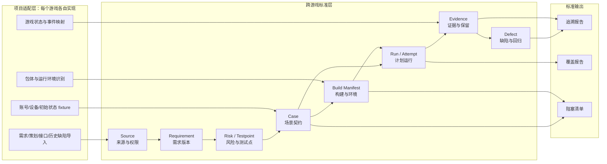

# M0：可移植的游戏测试数据基础

M0 是一套与游戏引擎、平台和自动化工具无关的测试数据规范。它只登记和校验事实，不安装包、不连接设备、不点击游戏、不调用模型，也不修改被测项目。

Idle_Outpost 只是当前仓库的示例输入；M0 的标准层不包含任何游戏名称、包名、场景名、升级规则或设备型号。换一个游戏时，只需要由项目适配器把本地资料映射成同一套记录。

## 结构图



标准层只关心“记录是什么、如何关联、何时算未知、如何统计”；适配层负责“从某个游戏哪里读取”。后续接入 Unity、Unreal、Web、小程序或不同缺陷系统，都不改变标准记录。

## M0 的实际组成

| 组件 | 当前实现 | 验收方式 |
| --- | --- | --- |
| M0Registry | src/ai_test_agent/m0.py | 创建、保存、加载、严格校验注册表 |
| 来源与需求 | sources、requirements | 权限、来源版本、需求版本和引用关系 |
| 风险与测试点 | risks、testpoints | 需求下挂风险，风险下挂测试点 |
| 场景契约 | cases | 构建、环境、设备别名、账号别名、初态、步骤、预期、恢复授权 |
| 构建清单 | builds | artifact 哈希、包版本、环境来源、server/resource/DLL 状态 |
| 计划运行 | runs | PLANNED/BLOCKED/PASS/FAIL、attempt、初态和阻塞原因 |
| 证据登记 | evidence | run_id/attempt_id 回链、类型、哈希、敏感级、保留期限 |
| 缺陷登记 | defects | 发现运行、分类、确认状态；证据不足不能伪装成游戏缺陷 |
| 覆盖统计 | coverage_report() | 计划、执行、阻塞、证据完整数量和状态分布 |
| 追溯报告 | report-m0 | 来源→需求→测试点→用例→构建→运行→证据→缺陷 |

## 一条 M0 记录如何闭环

1. 适配器登记一个已授权来源，记录来源版本、权限和引用位置。
2. 登记一个构建清单。任何 server、资源版本、DLL、源码对应关系未知，都保留为 unknown 并阻止依赖它的执行。
3. 登记需求、风险、测试点和已审核场景契约。场景必须绑定构建、环境、设备别名、账号别名和初始状态。
4. 创建 PLANNED 或 BLOCKED 运行。M0 不启动游戏；它只证明运行计划完整或说明为什么不能执行。
5. 将预期证据登记为 PLANNED，将真实证据登记为 COLLECTED 并校验哈希；原始文件留在本地受控目录。
6. 导出覆盖和追溯报告。BLOCKED 和 PLANNED 永远不计为执行通过。

## 通用适配器边界

适配器向 M0 提供以下标准字段：

- source：来源引用、版本、授权、内容摘要和是否允许发送给模型。
- build：包/构建类型、哈希、包标识、版本、环境、运行时 server/resource/DLL 身份。
- case：场景步骤、独立预期、前置状态、设备/账号 fixture、超时、恢复方式和审核人。
- evidence：证据类型、相对引用、采集时间、哈希、敏感级、保留分类和责任人。
- defect：业务失败或基础设施问题的分类、确认状态、复现运行和回归关系。

游戏专属信息放入 extensions.<adapter_id>，例如 Unity 的窗口路径、Unreal 的 GameplayTag、Web 的 DOM locator；标准层不会读取这些扩展，也不会把扩展字段当成跨游戏必需字段。

## 本地验收

```powershell
$env:PYTHONPATH = "src"
python -m unittest discover -s tests -p "test_m0*.py" -v
python -m compileall -q src
python -m ai_test_agent validate-m0 fixtures/m0-registry.example.json
python -m ai_test_agent report-m0 fixtures/m0-registry.example.json --output .local/m0-report.json
```

当前通用 fixture 的预期结果是：planned_cases=1、executed_cases=0、blocked_cases=1、evidence_complete_cases=0。它验证的是数据链和阻塞口径，不代表任何具体游戏已经执行。
