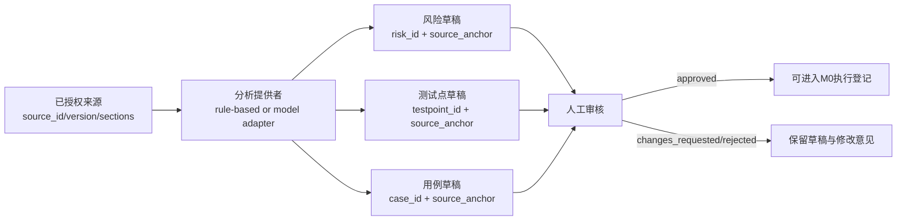

# M1：设备无关的需求分析与用例草稿

M1 建立在 M0 标准记录之上，负责把已授权来源资料转换成带来源锚点的风险、测试点和用例草稿。

## 当前边界

- 默认使用 RuleBasedAnalyzer 作为离线基线，保证没有模型 API 时也能验证数据协议。
- 来源先经过 requirements.normalize_source：保留原文、计算 section/content SHA-256，并拒绝重复键、NaN、哈希篡改和未授权权限。
- 后续模型只需实现同样的结构化输出，不改变 source_anchors、review_status 和人工审核规则。
- M1 不安装包、不连接设备、不执行游戏动作；设备动作属于 M3 以后。
- M1 生成的是草稿。没有人工审核，不能进入执行集。
- M1 审核通过也不等于可执行；promote_to_m0 会保留分析来源和 provenance，并在缺少 build/environment/device/account/initial state 时返回 BLOCKED。

## 输入与输出



每个风险、测试点和用例必须引用 source_id、source_version、section_id、locator。分析器不能补造价格、等级、账号状态或环境信息；未知值必须保留为 null 并要求人工补充。

结果还会记录 analysis_id、分析器版本、输入摘要、confidence、coverage_gaps 和 review history。相同来源内容哈希、分析器版本会产生稳定 ID，来源内容变化会生成新的分析结果。

M1 同时支持两种输入：离线规则基线和本次会话生成的 session_ai 结构化结果。session_ai 结果只能通过 import-m1 严格导入，不能把 JSON 中的 approved 标记当成真实审核。

promote-m1 有两种结果：没有真实 M0 绑定时生成 BLOCKED handoff；提供 build、环境、设备别名、账号别名、初始状态和 M0Registry 后，才会生成可再次由 M0 校验的 draft case，且不会创建 run。

## 本地验收

```powershell
$env:PYTHONPATH = "src"
python -m unittest discover -s tests -p "test_m1*.py" -v
python -m ai_test_agent analyze-m1 fixtures/m1-source.example.json --output .local/m1-draft.json
python -m ai_test_agent import-m1 .local/m1-draft.json --output .local/m1-imported.json
python -m ai_test_agent review-m1 .local/m1-draft.json --output .local/m1-reviewed.json --reviewer qa-owner --decision changes_requested --comment "bind exact independent expectation"
python -m ai_test_agent promote-m1 .local/m1-reviewed.json --output .local/m1-promotion.json
```

approved 只有在人工补齐独立预期并明确审核人后才能为 true。M1 验收通过后，才进入下一阶段；M3 设备自动化仍保持暂停。

`import-m1` 是会话分析导入边界：它不调用模型，也不相信输入文件的“已批准”标记；输入必须重新通过来源哈希、section 锚点、confidence 和审核结构校验。`promote-m1` 只生成 M0 handoff，缺少真实构建、环境、账号和初态绑定时保持 BLOCKED。
