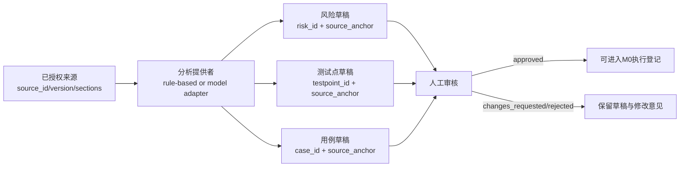

# M1：设备无关的需求分析与用例草稿

M1 建立在 M0 标准记录之上，负责把已授权来源资料转换成带来源锚点的风险、测试点和用例草稿。

## 新增验收要求：全自动文档分析

M1基础协议和全自动文档分析首版已于2026-10-16由用户确认验收。以下能力纳入M1必需验收范围：从原始文档直接启动，程序自动提取、真实调用模型、生成业务分析与可追溯草稿，再进入人工审核队列。不得先由会话人工编写分析JSON，再把导入成功当作全自动分析成功。功能验收不会将生成的业务用例自动标为已审核，真实文档的未读图片与覆盖缺口继续保留。

| 验收项 | 必须提供的证据 |
| --- | --- |
| 单命令读取真实文档 | 命令从DOCX路径开始，产物含原文件指纹和来源节 |
| 完整提取 | 正文、表格、删除线、内嵌XLSX和图像清单；错误worksheet dimension不导致漏读 |
| 真实AI生成 | 模型提供者/模型/Prompt协议版本、调用耗时和可用用量；输出含需求、风险、测试点、用例和问题 |
| 图像与来源覆盖 | 每节有覆盖处置，每张实际附件有可读性记录；漏读/无法读取生成缺口 |
| 独立模型配置 | Codex CLI完成短期真实验证；OpenAI兼容API可配置并通过HTTP契约测试，外部实测状态单列 |
| 审核与追溯 | 有效来源哈希、锚点、独立断言；所有模型输出均DRAFT/PENDING，无自动批准 |
| 失败路径 | 权限、登录、网络、超时、拒答、截断和无效引用明确BLOCKED；不回退规则模板伪装成功 |
| 实际业务质量 | 真文档能识别冲突及关键边界；固定用例数量不作为质量保证 |

首版支持DOCX、UTF-8 Markdown/文本。DOCX中的PNG/JPEG以实际附件交给视觉模型；内嵌XLSX直接读取XML单元格，不执行公式。外链不自动抓取，无法处理的媒体/对象留有缺口。PDF、旧DOC、视频解码尚不支持。

## 全自动运行

```powershell
$env:PYTHONPATH = "src"
python -m ai_test_agent extract-document-m1 "需求.docx" --output-dir .local/m1-extract-001
python -m ai_test_agent analyze-document-m1 "需求.docx" --output-dir .local/m1-auto-001 --provider-config fixtures/m1-provider.codex.example.json --allow-model
```

`--allow-model`授权当前文档及图像发送到选定模型。未指定时只可提取，分析返回BLOCKED且不调用模型。每次使用新的输出目录，避免覆盖历史证据。Codex配置继承本机已有登录与模型设置，也可在provider JSON指定`model`；文档分析的`reasoning_effort`独立配置，默认`medium`，避免继承交互式任务的超长推理。适配器关闭shell、MCP和插件工具、使用read-only/ephemeral执行，输出只用于需求分析。

独立API使用[配置示例](../../fixtures/m1-provider.api.example.json)。将`base_url`与`model`改为实际服务，凭据放在`api_key_env`指定的环境变量，不写入JSON或仓库。支持Chat Completions兼容协议，默认严格`json_schema`；不支持该模式的网关可显式配置`json_object`，宿主仍严格校验。`token_limit_parameter`可选择`max_completion_tokens`或`max_tokens`。模型需支持文档图片，否则含图文档明确阻塞。

输出包括`source.json`、`document-manifest.json`、`model-output.json`、`analysis.json`、`coverage.json`、`human-review-request.json`、`m0-handoff.json`、`report.md`、`cases.csv`和`run.json`。完整原文/图像/调用证据仅在本地输出目录保存。

`run.model_calls`记录提供者调用尝试数，`completed_model_calls`记录成功返回数；这不等同于服务端计费请求数。用量仅在提供者实际返回时记录，不估算金额。首版整篇输入超出`max_input_chars/max_images`时阻塞，不截断文档；需要更长文档时可显式调高预算，分段聚合另行迭代。

`run.status=PASS`表示文档到草稿流程完成，不表示游戏测试通过。`human_review_status=PENDING`、`game_execution_status=NOT_EXECUTED`与`M0 handoff=BLOCKED`仍按原门禁保存。有未读图片或功能节时，保留可用草稿但将本轮分析标为PARTIAL/BLOCKED。

模型接口参考：[Codex非交互式结构化输出](https://learn.chatgpt.com/docs/non-interactive-mode)、[Chat Completions API](https://developers.openai.com/api/reference/resources/chat/subresources/completions/methods/create)。

## 当前边界

- `analyze-m1`使用RuleBasedAnalyzer作为离线协议对照；全自动验收使用`analyze-document-m1`真实模型，模型不可用时明确阻塞。
- 来源先经过 requirements.normalize_source：保留原文、计算 section/content SHA-256，并拒绝重复键、NaN、哈希篡改和未授权权限。
- Codex CLI与可配置独立API共用结构化语义输出，由宿主生成source_anchors、哈希和DRAFT，不改变人工审核规则。
- M1 不安装包、不连接设备、不执行游戏动作；设备动作属于 M3 以后。
- M1 生成的是草稿。没有人工审核，不能进入执行集。
- M1 审核通过也不等于可执行；promote_to_m0 会保留分析来源和 provenance，并在缺少 build/environment/device/account/initial state 时返回 BLOCKED。

## 输入与输出



每个风险、测试点和用例必须引用 source_id、source_version、section_id、locator。分析器不能补造价格、等级、账号状态或环境信息；未知值必须保留为 null 并要求人工补充。

结果还会记录 analysis_id、分析器版本、输入摘要、confidence、coverage_gaps 和 review history。相同来源内容哈希、分析器版本会产生稳定 ID，来源内容变化会生成新的分析结果。

M1 同时支持两种输入：离线规则基线和本次会话生成的 session_ai 结构化结果。两者都必须通过 import-m1 严格导入；不能把 JSON 中的 approved 标记当成真实审核。

promote-m1 有两种结果：没有真实 M0 绑定时生成 BLOCKED handoff；提供 build、环境、设备别名、账号别名、初始状态和 M0Registry 后，才会生成可再次由 M0 校验的 draft case，且不会创建 run。

## 人工结果与缺口报告

M1 现在提供两条设备无关的后续闭环：

- `record-m1-result` 将人工观察登记到分析结果的 append-only `result_history`。它校验用例、断言、分析输出摘要和证据 ID 的回链；`PASS`/`FAIL` 只能登记到已审核用例，`BLOCKED` 可以记录设备执行尚未开始的阻塞原因。它不会创建 M0 run，也不会连接设备。
- `report-m1-gaps` 读取历史缺陷数组并生成稳定的覆盖缺口报告，统计 normal/boundary/exception 计划、审核、人工结果、未执行用例、未覆盖来源章节、无测试点需求、无用例风险和缺陷链路。凭据、设备标识、悬空来源锚点和未知缺陷会被拒绝或保持阻塞；只有确认且可公开的 `known_bug` 才能列入 `m0_defect_ids`。

示例：

```powershell
$env:PYTHONPATH = "src"
python -m ai_test_agent record-m1-result .local/m1-draft.json .local/manual-result.json --output .local/m1-recorded.json
python -m ai_test_agent report-m1-gaps .local/m1-recorded.json --defects .local/historical-defects.json --output .local/m1-gap-report.json
```

## 本地验收

```powershell
$env:PYTHONPATH = "src"
python -m unittest discover -s tests -p "test_m1*.py" -v
python -m ai_test_agent analyze-m1 fixtures/m1-source.example.json --output .local/m1-draft.json
python -m ai_test_agent import-m1 .local/m1-draft.json --output .local/m1-imported.json
python -m ai_test_agent review-m1 .local/m1-draft.json --output .local/m1-reviewed.json --reviewer qa-owner --decision changes_requested --comment "bind exact independent expectation"
python -m ai_test_agent promote-m1 .local/m1-reviewed.json --output .local/m1-promotion.json
python -m ai_test_agent record-m1-result .local/m1-draft.json .local/manual-result.json --output .local/m1-recorded.json
python -m ai_test_agent report-m1-gaps .local/m1-recorded.json --defects .local/historical-defects.json --output .local/m1-gap-report.json
```

approved 只有在人工补齐独立预期并明确审核人后才能为 true。M1 验收通过后，才进入下一阶段；M3 设备自动化仍保持暂停。

`import-m1` 是会话分析导入边界：它不调用模型，也不相信输入文件的“已批准”标记；输入必须重新通过来源哈希、section 锚点、confidence 和审核结构校验。`promote-m1` 只生成 M0 handoff，缺少真实构建、环境、账号和初态绑定时保持 BLOCKED。

`report-m1-gaps` 的 `BLOCKED` 是报告结论，不代表命令异常；命令会写出完整报告并返回退出码 2，供 CI 或人工验收识别未闭环项。
