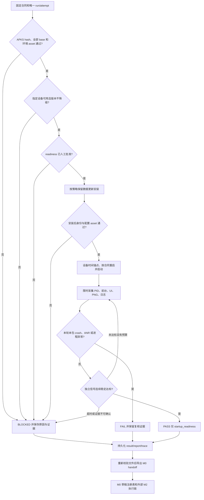

# M2：Android 确定性安装与启动冒烟

M2 工具正在实现和验收中。它核验批准的测试包、显式选择设备、按策略保留数据更新安装，并用独立的 readiness 合同判断启动是否就绪。每次执行均保存配置、轨迹、证据、结果和复跑标识，不调用模型。

`PASS` 的范围仅为 `scope=startup_readiness`；游戏升级、金币流水、账号进度等业务结果始终是 `business_status=NOT_EVALUATED`。PID 存在、前台属于本包、PNG 有效或测试服标志，都不能单独证明 readiness，更不能代替业务断言。

## 当前真实验收状态

截至 2026-10-16，当前选定的 Samsung 设备已安装 v66。现场两份 v66 包体均为正式服；旧 v65 测试包低于已装版本，在保留数据的更新策略下不能降级。当前等待不低于已装版本、身份和环境可核验的新版测试包，以及经人工审核的 readiness 信号。

合成测试用于验证工具的正反分支。真实包体预检能够留下 `BLOCKED` 证据，但这些结果均不构成 M2 实机正向通过。只有合法测试包完成安装、启动观测及同参复跑后，才能提交真实正向验收；当前不声称已经完成这一步。

设备标识、游戏包、账号、原始截图和日志留在本地。本文和[示例合同](../../fixtures/m2-contract.example.json)均不包含真实 serial、包名或游戏 hash。

## 准备合同

宿主需要 Python 3.11+、Android platform-tools、Java 和 bundletool。先在仓库根目录安装本项目，再把示例复制到被忽略的本地目录：

```powershell
python -m pip install -e .
New-Item -ItemType Directory -Force .local | Out-Null
Copy-Item fixtures/m2-contract.example.json .local/m2-contract.json
```

示例是结构完整的占位配置：全零 SHA-256、`com.example.game` 和工具路径均需替换；`readiness.approved=false`，信号列表为空，不授权设备变更。相对路径按运行命令时的工作目录解析；建议在仓库根目录执行，或把本地合同中的路径改为绝对路径。不得将含真实数据的本地合同提交进仓库。

| 字段 | 填写与核验要求 |
| --- | --- |
| `schema_version` | 固定为整数 `1`；未知字段和缺失字段被拒绝。 |
| `project_id`、`case_id`、`source_ref` | 绑定项目、启动用例及其真实来源；示例 URI 只是占位，不代表已审核来源。 |
| `adb_path`、`serial`、`device_alias` | 指定 ADB 和唯一目标设备。serial 不自动猜选，alias 使用安全目录字符，供证据目录和报告引用。 |
| `artifact_root`、`apks_path` | 本地证据根目录和待检 APKS。旧证据需保留，不能把不同包体视为同次运行。 |
| `expected` | 必须且仅含 `sha256`、`package`、`version_code`、`version_name`。hash 是整个 APKS 的批准 hash；其余字段与 APK 实际 manifest 比较。 |
| `environment_policy` | 指定配置 APK、安装后 APK 名、asset 路径、批准 asset hash 和字段读取方式，且有 `source_ref` 说明字段来源。 |
| `tools` | 显式填写 `java_path`、`bundletool_path`。 |
| `install_policy` | `if_needed`：已装身份或配置不符时更新；`always`：门禁通过后请求更新；`never`：只接受已装的批准测试配置。不自动卸载、清数据、降级或盲重试。 |
| `restart_before_launch` | `true` 时，门禁通过后受控 force-stop 本包，再启动；force-stop 保留应用数据。 |
| `readiness` | 独立信号、来源、连续稳定样本数和真实审核记录。未批准时不进入安装/重启/启动变更。 |
| `budgets` | `preflight_seconds`、`install_seconds`、`startup_seconds` 为 1–600 秒；`poll_seconds` 为 0.1–30 秒且小于启动预算。每条 Android 命令按当前阶段剩余时间约束。 |

`environment` 只能为 `test`。写入这个标签不能证明实际包体为测试服：必须读取实际配置 asset，通过 hash 和字段值门禁。APK 签名不由本模块判定，Android 更新安装负责签名身份检查。

### 环境策略

两种策略共用以下字段：`kind`、`archive_apk`、`installed_apk`、`asset_path`、`asset_sha256`、`expected_value`、`source_ref`。路径必须安全、明确，hash 对应批准的原始 asset 字节。

- `json_field` 额外且仅接收 `field_path`，例如示例的 `["environment", "server"]`。它逐层读取 JSON 对象中的标量；不执行表达式，重复字段和无法确认的值会阻塞。
- `uint32_le` 额外且仅接收非负整数 `offset`，从该字节偏移读取小端 uint32；`expected_value` 为对应整数。offset 必须来自可追溯的结构/字段说明，不能照搬其他构建的偏移。

先匹配 asset hash，再读取字段；hash 不符时不解释内容。字段比较同时检查类型，不能用 JSON `true` 冒充整数 `1`。该策略不内置某个游戏的包名、配置路径、服务器枚举或偏移。

包体预检会先匹配整个 APKS hash，再读取实际 base APK 的 binary AXML 或 XML。它核验所有受支持的 `splits/base-master.apk`、`splits/base-master_<数字>.apk` 与 `universal.apk`，并在存在 `toc.pb` 时核对可选 base 引用。每个变体都须匹配批准身份，SDK 元数据须一致；无法核验的 TOC 类型或 base 路径明确拒绝，不按 ZIP 顺序猜选。逐变体记录见 `artifact-inspection.json` 的 `base_apks`，全部 APK 的实际字节 hash 记录在 `apk_hashes`。

预检预算为：APKS 4 GiB，ZIP 中央目录 16 MiB、32768 项，单 ZIP 展开总量 8 GiB，待检 APK 1 GiB，manifest 4 MiB，TOC/配置 asset 各 1 MiB，base 变体最多 128 个。base APK 的内存读取阈值为 64 MiB，超过时流式落盘；大型 base 和配置 split 均写入本次证据目录，不覆盖原包，也不使用系统临时目录保存这些 APK。大小预算不等于对宿主磁盘 I/O 的可抢断墙钟超时。

### Readiness 审核

由项目测试/客户端负责人确认可区分“加载中”和“启动就绪”的日志或原生 UI 信号，写明 `source_ref`、`reviewer` 和带时区的 ISO `reviewed_at`。确认后才把 `approved` 改为 `true`。示例不预填任何信号，也不虚构审核人或审核时间。

`log_markers` 为字面子串，必须出现在本次时间窗口、当前目标 PID 的日志中；`ui_texts` 与目标包节点的 text/content description 精确匹配；`ui_classes` 与节点 class 精确匹配。所有配置的条件都要同时满足，再连续达到 `stable_samples`（2–20）。不要将 Unity 根 View 的存在批准为“已进入业务主界面”。

可选的顶层 `expected_runtime_server` 和 `expected_resource_version` 用于约束实现能够解析的当次运行字段。启用后，缺少观测值不会满足通过条件；源码开关或历史日志不能补齐运行时证据。这些字段也不会自动补齐资源/DLL 的业务追溯。

仅检查合同结构，不访问设备：

```powershell
python -c "import json; from ai_test_agent.m2 import validate_m2_contract; c=json.load(open('.local/m2-contract.json', encoding='utf-8')); errors=validate_m2_contract(c); print(errors); raise SystemExit(bool(errors))"
```

返回空列表只说明 schema 有效，未证明路径存在、包体通过、设备可用或审核完成。

## 执行、查看与同参复跑

```powershell
python -m ai_test_agent m2-smoke --contract .local/m2-contract.json
```

命令执行 M2，并在结果所在目录自动生成 `m0-handoff.json`。标准输出的 `result_path` 指向原始结果，其父目录即本轮 `run_dir`；每次执行生成新的 `run_id` 和 `attempt_id`，保留原记录。若合同内容保持一致，配置指纹 `config_sha256` 一致；改动路径、预算、设备或其他合同字段都会改变指纹。



安装命令退出码成功不足以通过：安装后仍须核对实际包版本、指定已安装 APK 的配置 asset，以及 base 和全部已安装 split 的实际文件哈希。设备需支持 `sha256sum`，不支持时明确阻塞；base 须匹配已核验的 base 变体，每个已装 APK 的字节哈希须属于目标 APKS。此检查证明已安装代码的来源，不替代业务模块覆盖检查。同版本、同环境 asset 但代码不同的构建仍需更新。

采集 UI/PNG 后再次读取 PID 和前台，再读取日志，避免用采集前的状态判断通过。日志使用设备时间边界，不清空 logcat；旧日志和其他包异常不判作本包故障。初始无进程时限时等待，已观测进程随后退出则失败。不能归属的异常、工具失败、未知环境或证据不足会阻塞判定。本轮确认的本包 crash/ANR、进程退出或重启才进入对应 `FAIL` 分支；由测试人员复核后再决定是否登记缺陷。

典型目录如下，具体文件随执行停留阶段而异：

```text
artifacts/m2/<run_id>/<device_alias>/
  contract.json                 本轮合同快照
  result.json                   M2 原始结果
  report.md                     启动范围的人读报告
  trace.jsonl                   命令、退出码、耗时及观测轨迹
  command-*-stdout.bin          原始命令输出
  command-*-stderr.bin
  artifact/artifact-inspection.json
  artifact/configuration-*.apk  流式落盘的配置 split
  observation-*.log/.xml/.png   实际采集到的观测
  m0-handoff.json               自动导出的交接
```

`result.evidence` 列出的文件附有大小、SHA-256 和目录绑定，包括原始命令 stdout/stderr。具体证据索引以结果中的 `evidence` 为准。截图还校验真实 PNG 结构；不能用空文件或伪后缀补证。报告采用临时文件原子替换，输出路径即使已有硬链接也不会截断原始证据。

重复同一条 `m2-smoke` 命令即可同参复跑。验收时分别保留两次的结果和证据，不把第一次的截图、日志或结论复制成第二次执行。

## 重新验证交接

对已存在的结果，使用本轮保存的合同快照重新验证并导出：

```powershell
python -m ai_test_agent m2-report artifacts/m2/RUN_ID/DEVICE_ALIAS/result.json --contract artifacts/m2/RUN_ID/DEVICE_ALIAS/contract.json --output artifacts/m2/RUN_ID/DEVICE_ALIAS/m0-handoff.review.json
```

该命令验证配置指纹、原始结果一致性、运行目录绑定和 `result.evidence` 中实际文件的大小/hash，检查 PNG 后输出交接 JSON 及相邻的 `m0-handoff.review.md`。它不重新执行设备操作，也不会通过修改 `status` 修复证据。导出不能覆盖输入结果、APKS 或已列出的证据。

| 命令 | 状态与退出码含义 |
| --- | --- |
| `m2-smoke` | M2 原始 `PASS` → 0，`FAIL` → 1，`BLOCKED` → 2；通过仅表示启动范围满足合同。 |
| `m2-report` | handoff 为 `READY_FOR_M0_REVIEW` 时，导出操作返回 `status=PASS`、退出 0；handoff 为 `BLOCKED` 时返回 `status=BLOCKED`、退出 2。原执行状态单独保存在 `m2_status`。 |

**导出成功不等于测试通过。** 原 M2 执行即使为 `FAIL`，证据和绑定完整时也可能得到可供复核的交接，`m2-report` 因而退出 0；必须继续查看 `m2_status`。格式无效、证据被改动或目录越界时不能产生可信交接。

交接包含 M0 草稿注册表和外部 M2 链：来源 → 启动用例 → 构建 → run/attempt → 原结果 → 实际证据。`m0_run_imported=false`，M0 case 仍未批准，不创建 M0 已执行 run，不伪造 M1 人工审核，也不把启动故障自动登记成业务缺陷。构建项中的环境是合同绑定，实际核验结论仍以 `artifact_verification` 为准。

`READY_FOR_M0_REVIEW` 表示交接可送审核；账号、初始业务状态、资源/DLL 运行时身份、业务断言及证据保留责任等仍列在 `unresolved_bindings` 中，不能用它扩大 PASS 范围。`BLOCKED` 交接则保留可验证的执行链和阻塞原因。

## 验收清单

- [ ] 合同由真实来源约束，环境策略和 readiness 有独立依据，未用示例值冒充审核。
- [ ] 合成正反例覆盖错误 hash/身份/环境、变体不一致、设备状态、降级、安装假成功、超时、晚到 ready、进程异常和证据损坏。
- [ ] 拿到不低于已装版本的批准测试包，在当前授权设备完成一次保留数据安装和启动观测。
- [ ] 同一合同再次执行，生成不同 run/attempt，保存两次实际证据和相同配置指纹。
- [ ] 导出时重新验证文件；报告清楚区分 M2 执行状态、交接导出状态及业务 `NOT_EVALUATED`。
- [ ] 提交审核前只发布脱敏材料；M2 工具验收和真实正向验收分别留记录。

当前真实阻塞尚未解除；后续首次升级业务闭环仍属于 [M3 路线](../roadmap/2026-10-09-implementation-framework.md)。
