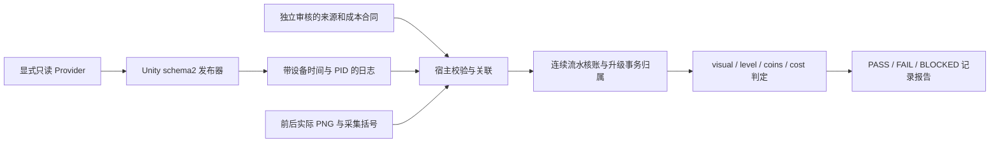

# M3.1：只读状态与流水证据

M3.1 是 M3 的只读协议首环：读取已有记录，关联升级前后状态、货币流水和实际 PNG，输出可复核的证据判定。本环没有接入真实游戏 Provider、制作或替换游戏包、连接设备或执行升级；真实业务接入和指定基线连续五次复跑仍属后续工作。

结果始终保留 `scope=readonly_upgrade_evidence`、`business_status=NOT_EVALUATED`、`execution=device_free`。`PASS` 只说明所提供记录满足当前证据合同，不能据此宣布真实游戏升级通过、M3 完整完成或新增 M0 已执行 run/业务覆盖。`FAIL` 表示记录中存在已知不符；是否为真实游戏 Bug，仍需后续接入复核。

## 结构与入口



协议解析在 `bridge_v2.py`；证据关联入口为 `m3_observation.assess_recording(recording, *, evidence_root)`；文件 CLI 为 `assess-recording-m3 INPUT --output PATH.json`。既有 schema1 的 `AI_TEST_STATE_JSON:`、`parse_snapshot_line` 和旧联合断言入口保留。

完整字段定义以[协议设计](../superpowers/specs/2026-10-16-m3-readonly-evidence-design.md)为准。可移植 JSON 模板见[合成记录](../../fixtures/m3-recording.example.json)，配套 PNG 由[样例生成器](../../examples/m3_recording_demo.py)创建。模板中的审核人、来源、账号替代标识和 trace 均明确为合成数据。

## 无设备复跑

在仓库根目录使用 Python 3.11 或更高版本。以下为 PowerShell 命令；直接运行源码时先设置模块路径：

```powershell
$env:PYTHONPATH = 'src'

python examples/m3_recording_demo.py --output-dir .local/m3-demo/pass --scenario pass
python -m ai_test_agent assess-recording-m3 .local/m3-demo/pass/recording.json --output .local/m3-demo/pass/review.json
# 判定退出码：0，PASS

python examples/m3_recording_demo.py --output-dir .local/m3-demo/wrong-debit --scenario wrong-debit
python -m ai_test_agent assess-recording-m3 .local/m3-demo/wrong-debit/recording.json --output .local/m3-demo/wrong-debit/review.json
# 判定退出码：1，FAIL

python examples/m3_recording_demo.py --output-dir .local/m3-demo/missing-event --scenario missing-event
python -m ai_test_agent assess-recording-m3 .local/m3-demo/missing-event/recording.json --output .local/m3-demo/missing-event/review.json
# 判定退出码：2，BLOCKED

python -m ai_test_agent assess-recording-m3 .local/m3-demo/pass/recording.json --output .local/m3-demo/pass/review-repeat.json
# 同一输入再次判定：0，PASS
```

生成器要求新目录或空目录，遇到已有产物即拒绝；再次完整生成时请更换目录。生成器输出的 `status=PASS` 只表示合成文件生成成功，后续 CLI 才进行证据判定。每个目录包含 `recording.json`、`before.png`、`after.png`；每次 CLI 成功写出结果时生成指定 JSON 及同名 Markdown。

| 场景 | 合成数据 | 判定与退出码 |
| --- | --- | --- |
| `pass` | 余额 `100.25`，同期 external 收入 `+1.25`，升级扣款 `-10.05`，最终余额 `91.45`，等级 `1→2` | `PASS` / `0` |
| `wrong-debit` | 独立期望仍为 `10.05`，实际扣款为 `9.05`，流水与最终余额相符 | `FAIL` / `1` |
| `missing-event` | 删除区间内的收入事件，流水缺少必要覆盖 | `BLOCKED` / `2` |

CLI 从输入文件父目录确定 `evidence_root`，不访问设备、ADB 或模型。输出必须以 `.json` 结尾，JSON 和相邻 Markdown 各自采用原子替换，禁止覆盖输入或 PNG 证据及其文件别名。为保留复核历史，应为每次判定使用不同输出名。重复判定同一输入时，`input_sha256` 相同、`assessment_id` 不同；输出路径和判定 ID 可以不同，断言结论应保持一致。

## schema2 观测合同

每条观测使用 `AI_TEST_OBSERVATION_JSON:` 标记。所有对象都要求精确字段集合：缺失、未知或重复字段均拒绝。普通文本上限 512 字符，日志上限 4 MiB，单个流水窗口上限 4096 个事件；观测序号、等级和事件整数按有符号 64 位约束，frame 为非负 32 位有符号整数。

根字段为 `schema=2, session_id, seq, frame, provider, source, target, wallet, ledger`。`seq` 为正整数，stream 内递增，frame 非负且不倒退。一个 `ObservationStream` 只接收一个 session、provider 和完整 runtime identity；新尝试需新建 stream。重复/倒序观测、来源变化、流水窗口回退、重叠事件内容变化或跨序号重用 transaction ID 均拒绝，失败不推进已接受状态。

| 对象 | 可用时的字段规则 | 不可用标记 |
| --- | --- | --- |
| `source` | `available=true`；`build_id/resource_version/dll_version/server` 齐全，来自实际运行环境 | `available=false`，四项均为 `""` |
| `target` | `available=true`；`target_id/window_id` 非空；`level>=0`；`cost` 为非负精确金额；`ready` 为显式 bool | 标识及 cost 为 `""`，`level=-1`，`ready=false` |
| `wallet` | `available=true`；`currency_id` 非空；`balance` 为非负精确金额 | 币种及余额均为 `""` |
| `ledger` | `available=true`；`complete` 显式声明完整性；`first_seq/last_seq/events` 构成连续窗口 | `available=false, complete=false, first_seq=1, last_seq=0, events=[]` |

空流水窗口满足 `first_seq=last_seq+1`。每个事件精确包含 `seq, transaction_id, operation_id, kind, target_id, currency_id, delta, balance_after`。事件 seq 连续、transaction ID 唯一；kind 仅 `upgrade` 或 `external`。upgrade 的 operation/target 必填；external 允许这两项为空，currency 始终必填。

所有金额均为最多 1024 字符的十进制字符串，保留原精度；不接受 float、指数、`NaN`、无穷大或 UI 缩写。cost/balance/balance_after 非负，delta 可正可负。未知金额必须使用对应不可用标记，不能填 `"0"` 冒充已测值。宿主核账按输入精度和事件数量设置 Decimal 上下文，避免默认 28 位精度造成舍入。

Python 接口：

```python
from ai_test_agent.bridge_v2 import ObservationStream, parse_observation_line
from ai_test_agent.m3_observation import assess_recording

value = parse_observation_line(log_line)  # dict；金额保持原始字符串；无效时 ValueError
stream = ObservationStream(expected_source=runtime_source, expected_provider=provider_id)
value = stream.parse_line(log_line)      # 加入跨行来源、序列、重叠流水校验
result = assess_recording(recording, evidence_root=evidence_directory)
```

`runtime_source` 可传四项 runtime 字段，或包含 `available` 的完整 source 对象。单行解析只做协议校验；金额与结构合法不能证明 Provider 本身可信。

## 记录包与证据绑定

记录包根字段精确为 `schema_version=1, evidence_mode, contract, before, after`，evidence_mode 仅 `synthetic` 或 `recorded`。合同字段为：

```text
approved, reviewer, reviewed_at, source_ref, cost_source_ref,
provider, runtime_source, device_alias, pid,
target_id, window_id, currency_id, operation_id, expected_cost, trace
```

`approved` 必须为显式 true，reviewed_at 为带时区的 ISO 时间。`runtime_source` 记录 build/resource/DLL/server 四项；trace 精确含 `requirement_id, case_id, source_ref, run_id, attempt_id`，其中 source_ref 必须与合同一致。这些 ID 用于追溯，不会创建或更新 M0 run。

`expected_cost` 应来自独立审核的需求或配置规则，不能复制被测 `target.cost` 作为期望。`source_ref/cost_source_ref` 是审核者对来源及独立性的声明；解析器没有认证引用内容，也不会用关键词自动证明其真实或独立。合成样例审核人明确标为 `synthetic fixture`，不代表真实用户审批；切换为 recorded 或改名不能建立可信来源。

before/after 各含 `line, capture`。line 必须保留设备时间、PID、线程 ID、级别和 Unity tag 的 threadtime 前缀；仅 marker/JSON 不够。capture 精确含 `device_alias, pid, log_start, log_end, session_id, seq, observer, visual_confirmed, visual_review_ref, screenshot`。

- 设备替代标识和 PID 必须与合同及日志绑定；session/seq 必须对应观测。前后同 session、provider、运行来源、target/window 和币种，seq 递增，frame 不倒退。
- 时间格式为 `MM-DD HH:MM:SS.mmm`。日志时间落在采集括号内；每次采集不超过 10 秒，前后严格有序且不重叠，总窗口不超过 120 秒，支持跨年短窗口。
- observer 仅 `manual` 或 `bridge`；`visual_confirmed=true` 和 visual_review_ref 是显式视觉来源确认，不能视为自动图像识别或同帧原子截图证明。
- screenshot 精确含 `evidence_id, path, bytes, sha256, width, height`。宿主读取并校验真实 PNG 内容、字节数、哈希和尺寸；解析后路径必须在 evidence_root 内。前后证据 ID 和实际文件必须不同，禁止同路径、符号链接逃逸或硬链接复用。

相同像素本身既不证明升级，也不否定业务变化。原始日志、截图、账号、真实设备与服务器标识保持本地；公开样例和报告使用明确合成数据或经过审核的脱敏值。

## 连续流水与联合判定

after 的完整流水必须覆盖 `(before.last_seq, after.last_seq]`，不允许缺口、重复或事务重用。历史重叠内容必须一致；目标币种逐事件核对 balance_after，从 before 余额核算到 after 余额。其他币种事件保留在序列完整性检查中，但不计入目标币种余额。

区间内必须恰有一个 upgrade，且其 operation/target/currency 与合同绑定；额外升级或归属不符会阻塞。其余目标币种 external 事件求和得到 `non_upgrade_delta`，调用方不能直接提供该值。只有来源、PNG、时序与流水上下文完整有效，才进入既有 visual/level/coins 联合断言和新增 cost 检查。

实际扣款和升级前展示成本均需匹配独立 expected_cost，等级需恰好 +1。可解释的完整记录中成本或等级不符为 `FAIL`；数据不可用、流水缺失、来源/时间/PID/PNG 不匹配为 `BLOCKED`。即使余额差看起来刚好，缺少事务归属也不能通过。

## Unity 接入与本环验收

[Unity 桥说明](../../integrations/unity-test-bridge/README.md)列出 `IGameTestObservationProvider` 和 `GameTestObservationPublisher` 的接入方法。只在 Unity 主线程显式 Install 后调用 ReadObservation；发布器只填 session/seq/frame/provider 等传输信息，不调用升级接口、不写入金币或等级，也不把 available/complete/ready 自动提升为 true。

独立合成 Unity Host 已验证缺少新发布器时 RED、实现后 GREEN，并将发布日志交给 Python schema2 解析；五种编译符号组合的二进制检查验证了 guard 行为。它们证明合成宿主和编译边界，尚不能替代真实 APK/AAB 的发布排除检查或正式游戏 Provider 验证。

本环验收可按以下顺序复核：

1. 运行上述三组文件流程，确认退出码分别为 0/1/2，PNG 与输入记录仍保留。
2. 对同一 PASS 输入写出第二组报告，确认 input_sha256 相同、assessment_id 不同、断言结论一致。
3. 检查报告始终为 readonly scope、device_free、business NOT_EVALUATED，并保留来源、trace、事务和哈希。
4. 运行协议、关联、CLI/pipeline 与旧入口回归；实际命令和结果以[本轮验证记录](../verification/2026-10-16-m3-readonly-evidence.md)为准。
5. 首环验收后，再单独审核真实 Provider、测试包构建、输入动作及五次业务复跑，不将合成 PASS 计入真实执行覆盖。
