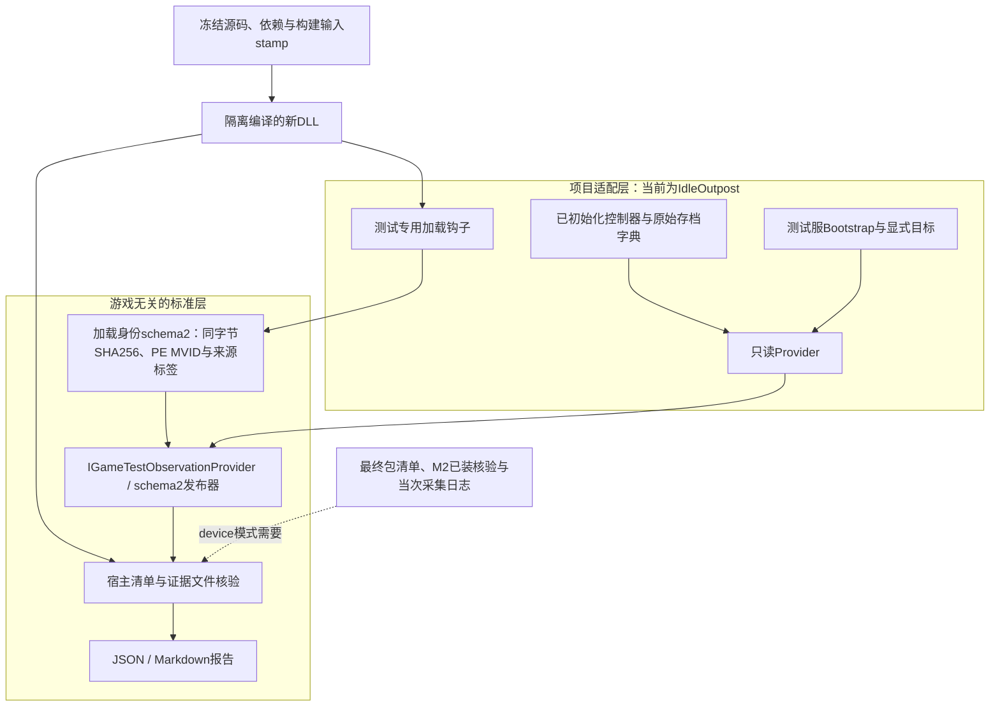
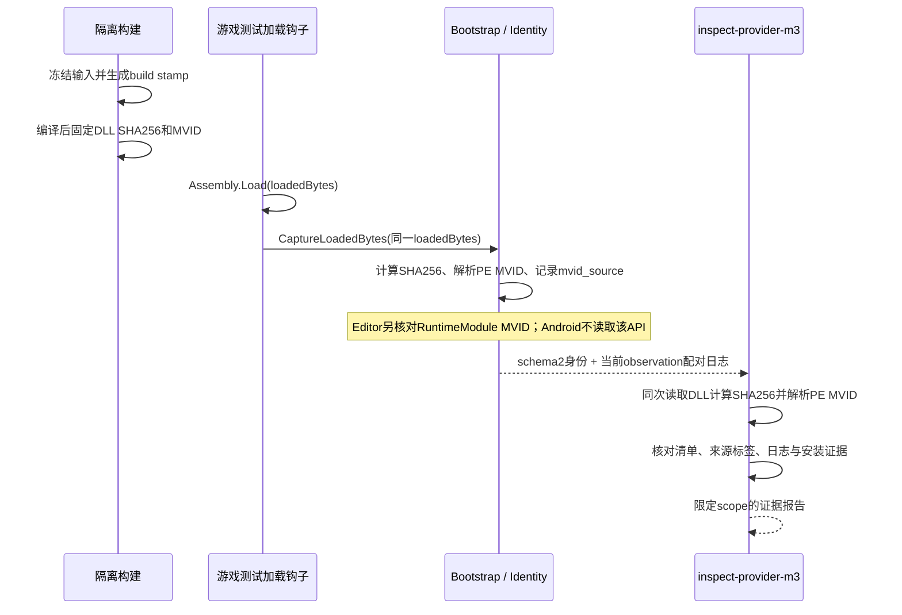

# M3.2：真实只读 Provider 与运行身份握手

M3.2把M3.1的通用协议接到项目专用读取点，并校验“准备编译的来源、实际加载的DLL、提供的运行记录”是否一致。当前身份合同为schema2，补齐Android IL2CPP的MVID来源区分。R3已完成资源1019专包构建、两轮实际安装启动和只读状态采集，source、钱包及明确目标窗口均可用，等待用户验收后合并。首次升级、金币扣减及完整账本业务仍未评估。执行结果见[实机验证记录](../verification/2026-10-16-m32-android-device-loop.md)，构建步骤见[专用包计划](../superpowers/plans/2026-10-16-m32-device-package.md)，此前Editor结果保留在[历史验证记录](../verification/2026-10-16-m32-runtime-provider.md)。

## 结构与可移植边界



| 层 | 主要文件 | 换游戏时的工作 |
| --- | --- | --- |
| 通用C#身份 | `Runtime/GameTestLoadedAssemblyIdentity.cs`、`Runtime/GameTestPeModuleIdentity.cs` | 保留；提供真实加载字节和对应Assembly，区分Editor API与Android PE来源 |
| 通用状态协议 | `Runtime/GameTestObservationPublisher.cs`及DTO | 保留；实现同一Provider接口 |
| 游戏适配 | `Adapters/IdleOutpost/` | 替换读取点、目标/窗口映射、服务器和资源版本读取 |
| 隔离编译 | `tools/compile_bridge_probe.py` | 提供项目编译响应文件、源码范围和明确补丁 |
| 宿主核验 | `m3_handshake.py`、`m32.py` | 保留；提供该项目的预期身份和真实证据 |
| 项目构建recipe | `Editor/BuildRecipes/IdleOutpostDedicatedBuild.cs` | 替换项目构建API及合同；独立编译守卫，不属于通用核心 |

C#文件路径均相对于[Unity桥目录](../../integrations/unity-test-bridge/)。迁移并非零配置：需要审核新游戏的getter是否写入默认值、货币精度、窗口语义、热更加载和构建符号。核心不会自动学习出可信业务映射；迭代必须带新的来源、回归和人工验收。

## 当前适配器读取什么

`IdleOutpostReadOnlyProvider/v1`只读已有GameEntity缓存控制器和UserData字典。缺少控制器、键或可信数据时返回不可用，不创建默认设备、补零金币或调用刷新成本/等级的业务方法。

- 目标由显式terrain/device标识指定；默认`0/0`不自动选首个设备。运行等级须与已有存档一致，成本读取已计算的`Device.Cost`。
- 钱包遵循已加载金币配置的公共/地块作用域，读取已有`GuardDouble.Value`。使用引用空值判断，避免游戏类型重载的比较运算触发异常。
- 金额将源double以InvariantCulture往返格式展开为无指数文本；这保留源值的往返表示，不增加源数据本来没有的精度。负值、非有限值、缺键均不可用。
- 窗口映射按实际配置修正为`UIGroupEnum.Main=100`，只遍历已有Main窗口，确认打开、活动及目标对象引用一致；固定读取已核实的`m_Upgradeable`成员。升级窗口配置ID4实际属于Main，不能因其视觉上覆盖游戏画面而假定为PopUp。窗口缺失、关闭、目标不匹配或读取失败时target整体不可用，标识/成本为空、level=-1、ready=false，避免发布违反schema2的半可用目标。`ready`只表达适配器声明的窗口/目标条件，不能证明未遮挡、坐标可点或全部业务前置条件满足。
- 账本保持`available=false, complete=false`。现有事件没有本适配器所需的权威事务ID，不能拼出一份看似完整的升级流水。

`IdleOutpostBridgeBootstrap.Begin()`在主线程显式安装Provider，默认目标为`0/0`；`BeginWithTarget(terrainId, deviceId)`要求两个正ID，并与默认入口共用同一宿主生命周期，不自动选择设备。默认每30帧先输出已捕获的身份，再输出当前observation，不重新捕获身份或重置session/seq。它只支持Unity Editor或Android Development Player，且仅在缓存控制器已指向TestServer时启动；异步资源读取失败或环境改变后释放启动占位，允许后续显式重试，活动宿主销毁时也释放自身状态。

通用发布器使用固定schema的`GameTestObservationJson.Serialize`，显式输出source、target、wallet、ledger及嵌套events。真实动态`Assembly.Load`探测发现Unity JsonUtility会静默省略这些嵌套部分，因而不能以`FromJson`后默认构造的空对象判断数据齐全。验收需独立解析原始JSON、核对完整字段及事件，覆盖引号、反斜线、Unicode、控制字符和64位整数边界；序列化转义通过本身不代表业务字段满足宿主协议。

## 编译身份与接入钩子

所有Runtime、Provider、Bootstrap及调用钩子使用：

```csharp
#if UNITY_EDITOR || (DEVELOPMENT_BUILD && AI_TEST_AGENT_BRIDGE)
// test bridge
#endif
```

Development和`AI_TEST_AGENT_BRIDGE`必须同时到达实际hotfix DLL编译过程。稍后Player选择Development不证明此前单独编译的DLL具备这些符号。运行时还检查平台，其他平台Player不会报告Android身份。



本次Android工具链的`RuntimeModule.ModuleVersionId`最终依赖`GetGuidInternal`；该IL2CPP实现不能返回可用的模块GUID，因而不能用作本包的运行时MVID来源。修复不修改Unity工具链，而是增加无第三方依赖的PE/CLI元数据读取器，从实际DLL的Module表及GUID堆读取MVID；C#与Python分别实现并交叉验证。工具链私有实现不包含在公共仓库。

`GameTestLoadedAssemblyIdentity.Capture(byte[], Assembly)`用于Editor：从字节解析PE MVID，并与实际Assembly的RuntimeModule结果交叉核对，来源标为`runtime_api`。`CaptureFromLoadedPe(byte[], Assembly)`用于Android：核对程序集名，从传入加载字节解析MVID和计算SHA256，来源标为`loaded_pe_metadata`，整个路径不读取RuntimeModule。已接受身份后，字节、程序集、MVID或来源变化都会令上下文失效，不能继续发布旧来源或切换来源恢复。加载边界须确保传入的是实际`Assembly.Load`使用的同一个byte[]；这些字段不认证记录者身份。

Player接入点位于实际`Assembly.Load`之后，经保留的单参反射入口`CaptureLoadedBytes(byte[])`传递同一数组，避免AOT反向引用hotfix类型，也不在AOT侧读取ModuleVersionId。Bootstrap按Editor/Android分别选择上述捕获API并如实标记运行类型。旧双参`CaptureLoadedAssembly(byte[], string)`仅保留Editor签名校验兼容，Android会直接拒绝。初始化钩子位于已有控制器初始化之后，使用`Begin()`或审核过的`BeginWithTarget(...)`；两处钩子仅接入私有测试副本，失败捕获后不阻断正常游戏启动。

`build_id`是编译前生成的输入stamp/nonce，由`AiTestAgent.Generated.ProviderBuildStamp.Value`提供；不是最终APK自哈希。编译后清单关联DLL实际SHA256/MVID，最终打包后再关联包SHA256。`source.dll_version`使用`sha256:<loaded DLL hash>`。资源号按实际BM模式选择：Local取内置版本`Item2`，Build取热更/内置版本的最大值，Develop保持未知；版本缺失或非正数时source不可用。服务器来自已初始化的缓存控制器。

## 宿主输入合同

`inspect-provider-m3`不连接设备、不调用模型、不执行游戏操作。输入JSON严格拒绝缺失、未知、重复字段和非有限数，金额沿用schema2规则。根字段精确为：

```text
schema_version=1, evidence_mode, mode, manifest, dll_path,
identity_line, observation_line, transport
```

`evidence_mode`为`synthetic`或`recorded`；改成recorded不会自动认证记录来源。manifest字段精确为：

```text
schema_version=2, runtime_build_id, provider, assembly_name,
dll_sha256, module_mvid, source_snapshot_sha256, runtime_kind,
resource_version, server, artifact, mvid_source
```

DLL须为证据根内的实际PE文件，最多256MiB。宿主从同一次实际文件读取的字节计算SHA256并解析Module MVID，两者分别与manifest核对；结果中`dll_metadata.verification=pe_cli_metadata`记录该校验范围。`source_snapshot_sha256`是清单提供的来源指纹，需结合隔离编译清单审核；宿主不据此重新构建游戏。身份行包含唯一`AI_TEST_LOADED_DLL_JSON:`标记，JSON字段精确为`schema=2, runtime_kind, build_id, assembly_name, dll_sha256, module_mvid, mvid_source`，逐项与manifest相等。外层recording的`schema_version`仍为1，observation的`schema`仍为2。

`mvid_source`必须与模式一致：`assembly_probe/editor_probe`仅接受`runtime_api`，`device/android_player`仅接受`loaded_pe_metadata`。旧schema1身份/manifest需在对应旧提交复评；不得修改历史日志行、补写来源标签后作为schema2证据提交。

| 模式 | 必要条件 | 成功范围 |
| --- | --- | --- |
| `assembly_probe` | `runtime_kind=editor_probe`；resource_version/server为空；artifact、observation_line、transport为null | `compiled_assembly_identity`，可用于复核新编译DLL的Editor加载身份 |
| `device` | `runtime_kind=android_player`；完整来源、最终artifact、schema2观测、采集日志和M2已装证明 | `provider_runtime_identity`，仅核验提供的设备记录 |

device的`artifact`精确含`sha256, package, version_code, version_name`；`transport`精确含：

```text
device_alias, pid, log_start, log_end, installed_proof,
log_evidence={path, bytes, sha256}
```

两条设备日志须保留threadtime Unity前缀、同一当次PID，落在不超过10秒的设备时间括号内，身份先于或同刻于观测。`log_evidence`指向根内实际采集文件，宿主校验字节数/hash，要求两条完整日志各出现一次且物理行顺序正确；支持LF/CRLF。日志文件最多64MiB，单行约4MiB。

`installed_proof`引用同一证据根内的M2结果，要求test环境、startup_readiness PASS、同设备替代标识/包版本/当前PID、最终包hash、实际安装的base和split APK hash及环境证明相符；其非空证据列表中每份文件也须重新hash。成功命令的stdout/stderr可以为0字节，仍须实际存在并匹配空文件的SHA256；DLL及采集日志保持非空要求。M2结果最多8MiB，单证据64MiB，总证据256MiB。所有路径解析后必须留在根内；原始数据只保留本地。

本轮Local专包关闭远端资源更新，不要求它生成原有热更流程的`localVersion/remoteVersion`日志。M2合同使用`expected_resource_version=null`，只按实际安装身份、环境配置和既有场景回调合同判断启动就绪；每份候选的资源号由各自最终包内版本文件与M3严格source交叉核对。R3的包内1019及两轮实际source1019均已核验，使用独立新清单与证据，R2资源1018保持历史记录。不得补造远端版本日志，也不能把M2 PASS扩展成资源版本或业务正确通过。

证据声明最多4096条。为避免保护范围被截断，已装证明超过8MiB或4096条时，CLI直接以INVALID_INPUT拒绝导出，不创建或覆盖报告；边界内仍按合同输出PASS/BLOCKED。单个非法路径声明不会遮蔽其他证据的输出保护。

所有成功结果仍固定`execution=device_free, live_provider=false, business_status=NOT_EVALUATED`。device模式名称只描述输入记录类型，不表示命令当下连接了设备或Provider仍在线；不创建M0已执行run。

## 运行与验收

在仓库根目录设置`$env:PYTHONPATH='src'`。采集完成后，使用实际schema2输入路径复评；下列`CAPTURE_ID`是待替换的示意文件名，不代表已有实机结果：

```powershell
$recording='.local/m32-device/device-recording-CAPTURE_ID.json'
python -m ai_test_agent inspect-provider-m3 $recording --output .local/m32-device/provider-review.json
python -m ai_test_agent inspect-provider-m3 $recording --output .local/m32-device/provider-review-repeat.json
```

私有输入及其DLL/日志不推送远端，其他环境须按合同准备自己的输入与证据。此前`.local/m32-provider-recording-postwire.json`属于提交`20bd0ff`的schema1历史记录，应使用对应版本复评并保留原件。当前命令成功退出0；证据不完整或身份不符为BLOCKED、退出2。输出JSON和同名Markdown各自原子替换，不能覆盖输入、DLL、采集日志、已装证明及其已声明证据或文件别名。M2证据的`path`及相对于已装证明父目录的`relative_path`声明均受保护，即使二者不符导致证明无效，也不能用BLOCKED报告覆盖任何一份原件。每次复评使用新输出名，核对相同input_sha256、不同assessment_id及相同结论。

隔离编译参数见`python tools/compile_bridge_probe.py --help`。该工具要求明确的项目/源码范围、响应文件、编译器、额外桥源码和新输出目录；冻结依赖，重建当前源码列表，拒绝嵌套响应文件、未支持开关和输出路径逃逸，将DLL/PDB等输出重定向到新目录。补丁必须匹配原文件hash及唯一锚点。编译清单及日志包含私有路径和来源，不能提交远端。

本轮验收依次检查：

1. 只读与恢复：缺数据不写入、钱包作用域/金额、目标/窗口、线程/平台/服务器门禁，以及Bootstrap失败和销毁后的恢复。
2. 真实源码编译：Editor与Android测试符号能够编译；release、仅development、仅bridge的二进制不含桥类型；原工作区来源和依赖hash未变。
3. 实际程序集探测：独立Unity Host读取新编译DLL字节、实际加载、调用保留入口并检查hash/MVID/stamp；独立解析序列化的完整嵌套字段，冷态Provider应保持不可用，不能据此宣布游戏初始化成功。
4. 宿主文件闭环：实际探测记录复核与同输入复评；改DLL/元数据、缺日志、过时已装证明或Editor/Android混用均阻塞。
5. 新专包另验最终包内文件、安装APK成员、schema2来源及真实只读source/wallet/目标窗口；用户审核通过后再合并。完整事务、一次安全升级和连续五次业务复跑独立验收。

## 专用测试包构建与当前边界

本轮包含AOT加载钩子变化，需要固定兼容源码/资源基线，在隔离副本接入桥和两个测试钩子，完成Unity导入、真实hotfix构建、AOT/IL2CPP及原Android Studio SDK工程的最终打包；固定签名、包版本、TestServer和资源号，生成最终包清单。仅替换已装旧包的hotfix DLL不满足该构建合同。

可审阅编排见[IdleOutpost专用构建recipe](../../integrations/unity-test-bridge/Editor/BuildRecipes/README.md)，入口为`AiTestAgent.BuildRecipes.IdleOutpostDedicatedBuild.Configure/BuildResources/ExportPlayer`。recipe仅在Editor且显式启用`AI_TEST_IDLE_OUTPOST_BUILD`时参与编译，要求`AI_TEST_BUILD_ROOT`下的GameProject/AndroidBuild/UnityExport布局；它依赖本项目构建API，通用核心及其他游戏不依赖这些API。本次实际执行使用私有编排，公开recipe是同body去路径对应版。

R2实机已通过屏幕打开目标升级窗口，画面显示等级1、成本8.71T，而Provider仍返回`target.available=false`；追溯实际配置ID4属于Main=100，旧adapter只读PopUp=200，因而漏掉真实窗口。修正后使用按UI组分离的合成回归，验证错误组、关闭、不活动、同ID不同对象及存档等级不符仍不可用；Editor/Android各10项行为及10项独立边界通过，发布/无opt-in守卫也通过。画面数值用于核对读取映射及显示粒度，不是独立成本期望或升级成功证据。

R3保留原存档，以版本67 / 2.1.2、资源1019完成两轮真实更新安装、启动和明确目标`terrain:47/device:215`的只读采集。两轮source、钱包、目标均可用，等级均为1、成本均为`8708971337959.25`，同窗截图显示等级1及8.71T；截图的缩写钱包显示不能替代精确金额。每轮严格核验170份文件，两轮合计340次引用校验。两轮使用相同配置和包体，run/attempt/PID/session不同；同一录制再经标准CLI复评两次，input SHA相同、assessment ID不同、结论一致。

该两轮只读闭环已完成，等待用户验收后合并。离线报告保持`scope=provider_runtime_identity, execution=device_free, live_provider=false, business_status=NOT_EVALUATED`；实时ADB执行、截图与安装证据另行留档。账本仍不可用/不完整，两轮钱包随时间变化不能用作扣款或零变化断言；本环没有判定业务升级通过。1017/1018的旧包、日志与记录保留原样，未重写为R3证据。详细结果见[实机验证记录](../verification/2026-10-16-m32-android-device-loop.md)，设备标识、账号、原始截图与日志只保留本地。

随后用M2核验最终包与实际安装，再采集当次PID的加载身份和schema2状态，将相应文件交给device模式核验。真实目标、钱包和窗口读值还须由截图及人工基线复核；补齐权威事务后才能开始首次升级业务闭环。发布包须另做最终包内容检查，当前Roslyn的类型排除证据不能代替最终APK/AAB验收。
