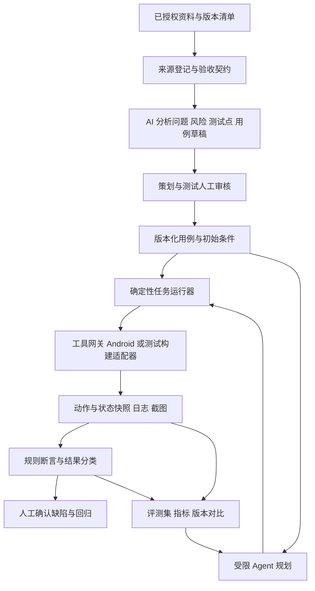

# Idle Outpost AI 辅助测试建设方案

- 状态：**用户已确认，首轮实施中**；本文件区分已验证能力与尚未接入的游戏侧桥。
- 方案日期：2026-10-09（Asia/Shanghai）。
- 游戏项目：`D:\Project\Idle_Outpost`；AI 测试工程：`E:\Ai-Test-Agent`。
- 方案与后续 AI 测试实现的远端：<https://github.com/caiyipeng2/AI-Test-Agent>。
- 本轮边界：用户已授权测试服包安装、游戏内删除测试账号和一次首次升级实测；不上传游戏源码/包体/原始敏感日志，不运行自主 Agent。

## 1. 要解决的问题与建设顺序

目标是把“阅读需求、设计用例、执行游戏操作、判断结果、处理缺陷、修复后回归”接成一条有证据、可追溯的流程，让 AI 减少测试人员的整理和操作负担，同时使测试结论能够被复核。

推荐顺序为：**数据与验收契约 → AI 辅助用例 → 确定性 Android 冒烟 → 测试构建状态桥与首次升级 → 受限 Agent → 评测治理 → 专项扩展**。每一阶段只有在自己的最小闭环验收后才进入下一阶段。当前先确认全局框架，后续分别形成各阶段的详细执行计划。

| 路线 | 得到的能力 | 主要代价与限制 | 选择 |
|---|---|---|---|
| 流程与证据优先 | 先有可复现用例、执行器和判定依据，再增加 AI 自主性 | 初期覆盖较窄，仍需人工审核 | 推荐；与当前发布包、缺少测试桥的条件一致 |
| Agent 操作优先 | 较快演示模型看画面、点击、探索 | 缺少业务真值时，难区分模型失误、网络延迟和游戏缺陷 | 仅作为后续受限探索，不作为首轮质量门禁 |
| 完整平台优先 | 一次建设资料平台、任务编排、评测和缺陷集成 | 接入多、验证周期长，容易在真实闭环前堆积功能 | 首轮不采用，按阶段补齐需要的能力 |

首轮交付成功的含义是：一条选定场景能从明确的初始状态出发，产生带版本的用例、执行轨迹、可信断言和结果；失败可以分类、回放和人工确认。它不意味着全面替代人工测试，也不意味着覆盖 JD 中所有平台。

## 2. 本轮核实的事实与尚不能推出的结论

### 2.1 项目现状

| 对象 | 本轮勘察事实 | 对方案的影响 |
|---|---|---|
| 游戏栈 | Unity `2022.3.62f2`、UGUI，使用 HybridCLR 与 BundleMaster 热更新体系 | 游戏画面操作之外，需要测试构建提供 Unity 内部状态；运行中的 DLL 和资源版本必须单独记录 |
| 源码 | `feature/Medal-Challenge`，勘察基线 `6e93c0841ff9e0e4f902c0953c4671f49c109190`，工作区有本地修改 | 不覆盖现有修改；后续游戏侧接入须使用隔离工作区并记录变更基线 |
| 本地配置 | 源码配置为 `_server: 2`（`ServerType.TestServer`），代码与资源热更新开启 | 只能说明当前源码配置，不能证明已安装包实际连接同一环境、加载同一资源或 DLL |
| 测试包 | 2026-09-23 21:12 的 V65 release AAB/APKS，版本 `2.1.1`，包名 `com.hg.idleweaponshoptycoon.android`；同版本 21:55 为正式服 | 包内 `_server=2`、资源版本 `995` 与运行日志 TestServer/995 已核对；不能默认对应当前源码 |
| Android 边界 | V65 包 `minSdk 24`、`targetSdk 36`；测试服实测使用 moto g 2025（API 35） | 先做单设备试点；旧资料中的 API 23 设备建议不能直接作为当前支持边界 |
| 可用状态入口 | 源码存在窗口、设备、引导任务状态读取点；通用桥已通过合成编译 smoke | 尚未接入 Idle_Outpost 测试构建，不能把通用桥协议当作游戏业务真值 |
| 测试桥 | AI-Test-Agent 已提供通用只读 Unity 桥和宿主解析器；尚未接入 Idle_Outpost 测试构建 | 当前发布包仍不能直接输出设备等级/金币流水真值 |
| 正式需求资料 | 尚未提供本轮新策划文档及业务验收规则 | 首先创建由策划/测试确认的“首次升级验收契约”；不得声称已由 AI 分析正式需求 |

本轮安装和现场证据单独保存在 [基线与安装报告](../../discovery/2026-10-09-baseline-and-install.md)。本设计不把安装完成写成登录、首次升级、服务器连接或游戏业务测试通过。

### 2.2 发布包与测试构建的能力边界

| 能力 | 当前发布包黑盒 | 经确认后新增的专用测试构建 |
|---|---|---|
| 包元数据、安装、启动、进程与 Android 日志 | 可做；实际结果以本轮报告为准 | 可做 |
| 截图、画面变化、有限点击与页面观察 | 已做；视觉确认须标注人工来源和不确定性 | 可做，并结合语义状态定位 |
| 确认设备等级、金币、任务进度、存档状态 | 视觉显示只能作为辅助证据，不能等同后台/存档真值 | 通过只读状态桥与独立验收规则判断 |
| 确认实际服务器、资源、热更新 DLL | 只有获取相应运行证据时才可确认 | 启动握手必须返回运行版本；服务端信息需认可的独立证据 |
| 可控账号基线和重置 | 不自行清除或覆盖存档 | 使用专用测试账号；主动重置另行明确授权 |

`pm clear` 只清除设备上的应用数据，不保证服务器生成新账号。源码登录链路使用设备标识；重新安装也不能当作“全新用户”。新手流程、首次升级必须先确认测试账号来源、服务器状态和初始进度。

### 2.3 必要证据定位

下列源码路径相对 `D:\Project\Idle_Outpost`，行号来自本轮勘察，不代表 V65 包运行的是这些代码；后续改动需更新引用。

- `ProjectSettings/ProjectVersion.txt`：Unity 编辑器版本。
- `Packages/Hlwd-Framework/Runtime/UIFramework/UICtrl.cs:345`：`GetAllOpenWindows`、`GetTopOpenWindowByGroup`、`HasOpen` 等窗口状态候选入口。
- `Assets/Scripts_Hotfix/GameCtrls/NodeCtrl/DeviceCtrl.cs:276`：`GetDeviceById` 与设备 ID/等级信息。
- `Assets/Scripts_Hotfix/GameCtrls/Guide/GuideCtrl.Task.cs:104`：`CurTaskPhase`、`CurTaskGroupID`、`GetCurrentTaskIds` 等引导状态候选入口。
- `Assets/Scripts_Hotfix/GameCtrls/WebRequest/WebRequestCtrl.Request.cs:42`：设备标识参与登录的链路。
- `Assets/Editor/Build/AndroidAutoTestQuickBuild.cs:19`：已有 Android 测试构建相关编辑器入口；可复用范围需在实施时验证。
- `Reports/AndroidRealDeviceTestContract.md`、`Reports/AndroidRealDeviceTestEnvironment.md`、`Reports/AndroidRealDeviceStartupSmoke.md`：2026-09-01 的历史资料，只作为流程参考，不能作为本轮通过证据，也不整体复制到 AI 测试远端。

## 3. JD 六项职责转成项目需求

图片中的内容作为目标参考，项目的实际平台、优先级和验收条件由本方案确认。当前已核实的起点是 Unity Android，图片提到的小程序、Laya、横竖屏及其他端须先确认项目是否存在，再扩展。

| JD 能力域 | 本项目的具体需求 | 最小交付 | 对应阶段 |
|---|---|---|---|
| 1. 功能测试与版本质量 | 绑定构建、账号、环境、配置、测试用例和设备，输出版本风险 | 一条场景从初始条件到结果的报告 | M0、M2、M3 |
| 2. AI 辅助流程与追溯 | 从已获授权的需求、配置、接口、变更、历史缺陷提取问题和测试点，补齐用例 | 带来源引用的用例草稿、人工审核、覆盖缺口 | M1 |
| 3. TestAgent | 在明确目标和工具白名单内感知、规划、执行，不直接修改游戏业务状态 | 受限任务的结构化计划和工具轨迹 | M3、M4 |
| 4. 缺陷链路与稳定性 | 分类失败、保留证据、去重、有限重试、人工确认缺陷、修复回归 | 一个失败能定位到版本/步骤/断言并再执行 | M2—M5 |
| 5. 评测与治理 | 黄金任务、带标签的正常/缺陷样本、固定回归集、版本比较、成本记录 | 同一批任务可比较模型/Prompt/工具迭代前后结果 | M5；基础记录从 M0 开始 |
| 6. 专项测试 | 按业务风险增加弱网、兼容、性能、长稳、热更/强更/回滚、接口与并发测试 | 每个专项有基线、执行证据、阈值和恢复方案 | M6 |

## 4. 总体流程和责任边界

| 模块 | 职责和输入输出 | 不越过的边界 |
|---|---|---|
| 资料登记 | 记录来源、版本、权限、摘要与引用；输入已授权资料，输出可追溯来源记录 | 未授权资料不发给模型；资料中的文字不作为执行指令 |
| AI 分析 | 输入文档/变更与已有用例，输出需求疑问、风险、测试点、草稿与来源引用 | 不凭空确定产品规则；没有资料时标明人工契约来源 |
| 人工审核 | 确认预期、风险等级、初始条件和可执行动作 | 审核用例不等于授权账号重置或生产操作 |
| 运行器 | 执行固定步骤或已接受的 Agent 计划，管理预算、等待、终止和轨迹 | 不让模型绕过工具网关 |
| 工具网关与适配器 | 校验目标环境/账号/构建、参数与操作白名单；返回带时间戳状态和证据 | 无任意代码执行、任意 shell、任意数据库写入接口 |
| 结果判定 | 依据独立验收规则和状态真值输出通过、业务失败、基础设施失败或无法判断 | 截图相似、模型“认为通过”、工具返回成功均不能独立代表业务通过 |
| 缺陷与回归 | 先生成脱敏草稿，经人工确认后进入现有缺陷系统，关联修复版本和回归记录 | 首轮不自动建单、不自动修复游戏业务代码 |
| 评测治理 | 固定数据集和基线，比较成功、误报、漏报、稳定性、耗时、成本 | 不能只报经过重试的最终通过率，不能把阻塞任务悄悄删除 |

首轮采用文件化结构记录和命令行/报告入口，先建立数据契约和闭环；是否建设网页平台、连接飞书/其他缺陷系统由后续需求决定。模型通过可替换调用接口接入，不预设供应商、部署方式或价格。

## 5. 各阶段最小闭环

### M0：数据、版本与场景基础

- **输入**：本轮勘察/安装证据、游戏构建元数据、已授权测试环境、首个场景提议。
- **步骤**：登记资料和权限 → 固定包/源码基线关系 → 建立 ID 与结果分类 → 选定测试账号和初始条件 → 由业务人员确认首次升级验收契约。
- **输出**：版本清单、来源索引、场景契约、覆盖矩阵、证据保留规则、待确认问题清单。
- **出口**：抽查一条场景，能够解释“测试哪一包、哪个环境、哪个账号、从什么状态开始、用什么依据判定”，未知项明确标为阻塞项。
- **边界与恢复**：只登记信息，不重置账号或改变游戏状态；记录修订保留旧版本，不覆盖既有证据。

### M1：需求分析、测试点和用例

- **输入**：已授权的正式策划资料及确认规则；若未提供，则只使用明确标注的人工验收契约。
- **步骤**：资料解析与来源定位 → AI 提取疑问和风险 → 拆解正常/边界/异常测试点 → 检查历史缺陷与现有用例缺口 → 生成结构化用例 → 策划/测试审核 → 固定可执行版本。
- **输出**：需求疑问清单、风险、测试点、用例草稿、审核记录、需求覆盖缺口。
- **出口**：每条启用用例都有来源、前置条件、步骤、明确预期和判定依据；缺少业务规则的条目保留为待确认，不能进入自动执行。
- **新增必需验收（2026-10-16）**：一条命令从原始DOCX自动提取正文、表格、删除线、内嵌表及图像，真实调用模型输出需求/风险/测试点/用例草稿和问题；不得用会话人工预填分析JSON代替。支持本机Codex CLI短期验证和可配置独立API。未解析公式、缺图、失败调用及未知规则必须可见；用例始终进入人工审核。详见[M1全自动验收清单](../../m1/README.md)。
- **最小例子**：一份首次升级验收契约生成正常升级、金币不足和重复操作三个测试点，经人工审核后成为候选用例；没有正式资料时，报告不能写“完成正式需求 AI 分析”。
- **恢复**：不合格草稿不进入执行集，保留 AI 输出和人工修订记录。

### M2：确定性 Android 安装与启动冒烟

- **输入**：选定包的文件哈希与元数据、一个已授权设备、可重复的启动检查契约、账号/网络前置条件。
- **步骤**：校验设备和包 → 确认已安装版本或按已授权方式更新 → 标记本轮运行起点并按时间/进程开始捕获日志 → 启动 → 按明确超时观察进程、首帧/目标页面 → 采集截图与日志 → 分类并报告。
- **输出**：包与设备别名、安装/启动轨迹、截图、崩溃/ANR 线索、首帧时间、启动结果。
- **出口**：至少一条完整真机执行记录可回看；正常路径重复执行获得完整证据；通过模拟“设备未连接/错误包/超时”等安全工具级异常确认失败分类。启动画面正常不能被报告成首次升级通过。
- **边界与恢复**：默认保持应用数据，不清理全设备 logcat 缓冲，保留其他会话日志；卸载、清数据、改网络和强制停止等动作按批准的具体测试范围执行。退出运行器后释放工具连接，保存全部尝试。

### M3：专用测试构建状态桥与首次升级闭环

- **输入**：独立测试环境、专用账号、经确认的首次升级契约、与源码/资源/DLL 绑定的新测试构建、明确授权的基线恢复方式。
- **步骤**：在隔离工作区接入最小测试桥 → 构建并验证桥不进入发布配置 → 安装测试构建 → 握手读取运行版本 → 现场确认并冻结升级对象的 `upgrade_id/type` 与设备映射 → 读取账号/窗口/设备/金币/任务初态 → 等待场景就绪 → 通过真实 UI 执行一次指定对象的单次升级 → 读取终态与升级事务/收益/存档证据 → 执行独立规则断言 → 输出追溯报告。
- **输出**：测试桥能力声明、运行 manifest、首个业务用例、升级前后状态、输入轨迹、截图/日志、断言明细。
- **出口**：合法升级的等级变化与扣款符合确认规则；至少验证金币不足时状态不被错误修改；重复执行依赖合法基线恢复；无法证实持久化时明确记录为未验证，不能宣称存档闭环通过。
- **恢复**：终止任务后停止桥连接；仅按授权恢复测试账号状态。桥在正式发布构建不可用，由构建检查验证，不能只靠使用约定保证。

首次升级契约必须指定现场确认的 `upgrade_id/type`、设备映射/可见入口、初始等级、初始余额、价格和规则来源、单次升级模式、预期等级增量、该笔升级的预期扣款、允许的任务变化、保存完成标记及最大等待时间。不得把地块升级入口自动等同设备升级，不默认历史 `Level1_0/device1` 路线仍适用于 V65。首轮只允许单次升级，不启用长按、批量或最大升级。

放置收益、奖励或其他并发入账可能改变前后余额。货币断言优先核对该笔升级事务与已确认成本，并用同期收入/支出记录解释余额变化；或使用经确认的无并发收益 fixture。无法隔离或记录并发变化时，余额差不能直接等于升级成本，货币断言应标为无法判断。若为了测试暂停收益，必须明确记录该环境行为及其授权，不能把改变业务行为后的结果当成发布包已验证。上述预期均是待确认契约，不是已知 V65 规则。

### M4：受限 AI 规划与执行策略

- **输入**：M2/M3 已验证工具、固定场景、审核用例、工具白名单、步数/时间/调用预算。
- **步骤**：输入目标与只读状态 → AI 生成结构化下一步 → 网关校验范围 → 执行动作 → 读取新状态 → 规则断言/继续规划 → 成功、失败或预算到达时终止 → 保存完整轨迹。
- **输出**：模型/Prompt 版本、每步决策依据、工具参数与返回、终止原因、与固定脚本基线的差异。
- **出口**：同一验收契约下完成受限任务；越权、错误参数、重复扣费风险、版本不匹配或状态无法判断时能够拒绝并终止；不能降低 M3 的断言要求来提高成功率。
- **恢复**：可切回固定脚本和前一版本 Prompt/策略；已发生的业务动作不能被软件回滚假象掩盖，仍按账号恢复规则处理。

### M5：黄金任务、缺陷回归与治理

- **输入**：20—30 条暂定黄金任务、正常/已确认缺陷的标签、运行数据、固定脚本基线、风险等级和回归规则。
- **步骤**：区分调试集与冻结验收集 → 由人工确认标签 → 对正常样本和可控缺陷样本运行 → 抽查断言/误报/漏报 → 生成缺陷草稿并人工确认 → 修复版本执行同条件回归 → 对模型/Prompt/工具版本比较并设门禁。
- **输出**：指标看板或静态报告、版本比较、缺陷追溯、回归证据、能力退化与成本变化清单。
- **出口**：关键任务没有已知退化；标签、分母和失败分类可复核；受限 Agent 不达标时保持人工辅助或固定脚本方式。
- **样本限制**：20—30 条只能检验初步能力；如没有真实缺陷标签，只能报告正常样本表现，不能给出可信漏报率。一次零误报/零漏报不代表总体风险为零。
- **恢复**：回退模型/Prompt/工具配置到上一基线，保留新旧运行结果与未解决缺陷。

### M6：按风险扩展专项

- **输入**：设备分布、已确认支持平台、网络/性能基线、测试账号和环境、专项预算及破坏性动作授权。
- **步骤**：先选一个专项 → 定义负载/故障与阈值 → 验证注入和恢复工具 → 固定对照条件 → 执行 → 联合客户端日志/服务指标定位 → 回归并恢复环境。
- **输出**：专项契约、脚本或工具、监控证据、风险报告、可重复基线。
- **出口**：每个专项都能复现条件、判断结果、恢复环境；例如弱网闭环需证明“已注入指定条件、行为符合规则、网络恢复后可继续”，不能只截到断网提示。
- **顺序建议**：先启动弱网与低端兼容，再首次升级的中断/恢复和长稳；热更/强更/灰度/回滚在版本链可证实后接入；服务端压测由后端协作，不用 UI Agent 冒充并发压测工具。

## 6. 业务真值与测试桥设计原则

### 6.1 三条版本链同时记录

1. **构建链**：包哈希、包名、版本、签名指纹摘要、构建方式、源码 commit、本地变更清单与资源构建记录。源码与包无法对应时写“未建立对应关系”。
2. **运行链**：实际环境标识、客户端版本、正在加载的资源版本/哈希、HybridCLR DLL 版本/哈希、桥版本。热更新后重新记录；桥位于启动层时也必须报告热更业务层版本。
3. **账号与状态链**：测试账号别名、服务器环境、初始快照、每步快照、保存确认、最终快照。敏感标识保留在本地受控记录，远端报告只用别名。

当前源码的 `_server: 2`（`ServerType.TestServer`）不是已安装包实际服务器的证明。仅包版本一致也不能排除热更新资源/DLL 不同。获取不了运行信息时，依赖该信息的业务用例应阻塞或无法判断。

### 6.2 断言不能照抄被测代码

| 判定项 | 可信依据 | 辅助证据/不足以判定的依据 |
|---|---|---|
| 启动 | 进程状态、认可的首帧/页面契约、崩溃日志 | 单张加载图不能证明进入游戏 |
| 等级变化 | 指定设备的前后状态，预期来自确认契约 | 图标变化或工具调用成功 |
| 价格/金币 | 生效配置、独立规则、该笔升级扣款及同期收入/支出证据 | 直接调用被测价格函数证明自身；忽略放置收益直接用余额差判成本 |
| 任务推进 | 验收契约允许的任务 ID/阶段变化、实际任务状态 | 弹窗出现不等于任务已持久化 |
| 存档 | 已认可的保存完成证据及必要的重载/重进校验 | 内存余额/等级读数不能单独证明保存成功 |

配置类预期遵循“原始配置 → 生成/解析 → 解密后的运行配置 → 实际选择与生效状态”的核对链。未核实的源码默认值、历史 Excel 或未解密 txt 不能单独作为价格真值。规则未明确时输出需求疑问。

### 6.3 最小工具面

首批 Android 工具为设备发现、包信息、安装/启动、截图、日志采集、点击/输入、等待与进程检查；实际变更操作受已批准范围限制。测试桥首先提供握手、只读状态、窗口/语义目标定位和观测，不开放直接改金币、直接设设备等级、跳过业务逻辑等“通过捷径”。

UGUI 游戏常缺少完整 Android 原生 UI 树；方案不能预设 Android 文本选择器能够可靠定位游戏控件。优先用桥提供语义目标与当前 bounds，再由真实输入执行；视觉定位作为降级方式，坐标执行前校验分辨率、窗口和目标状态。

桥只允许测试构建、测试账号和指定环境；接口有版本、认证、参数 Schema、超时、请求 ID 和审计记录。连接优先使用受控设备转发与本机访问，不暴露公开网络端口。状态读取在 Unity 允许的线程执行，返回时间戳和状态修订号，避免混合不同帧的等级、余额和任务状态。

## 7. 数据对象、追溯与覆盖矩阵

所有对象采用稳定 ID 和可递增版本。正文只列核心字段，实施时形成可校验的数据契约。

| 对象 | 核心字段 |
|---|---|
| 来源/需求 | `source_id`、`source_version`、权限与引用位置、`requirement_id`、审核状态 |
| 风险/测试点 | `risk_id`、`testpoint_id`、需求引用、风险级别、平台、预期规则 |
| 用例 | `testcase_id`、`testcase_version`、前置条件、步骤、断言、环境、恢复方式 |
| 构建/运行 | `build_id`、artifact 哈希、`run_id`、`attempt_id`、设备/账号别名、运行 manifest、起止时间 |
| 证据/结果 | `evidence_id`、相对引用、采集时间、内容哈希、保留范围、断言结果与失败类别 |
| 缺陷/回归 | `defect_id`、确认状态、复现步骤、修复版本、回归 `run_id`、仍未覆盖项 |
| AI/工具版本 | `model_version`、`prompt_version`、`agent_version`、`tool_version`、`dataset_version`、调用与预算 |

追溯链为 `来源 → 需求 → 风险/测试点 → 用例版本 → 运行/尝试 → 断言/证据 → 已确认缺陷 → 修复版本 → 回归运行`。无法关联来源的用例保留其人工契约来源，不能补造文档引用。

| 覆盖维度 | 首轮范围 | 后续扩展与分母规则 |
|---|---|---|
| 平台/设备 | Android、S24 Ultra，一个真实设备 | 支持的 Android 版本/ABI/内存档；其他端存在与否先确认 |
| 构建/环境 | 发布包启动；新测试构建业务断言分别统计 | 资源/DLL/服务版本组合单独登记，不合并成一个包版本 |
| 账号/进度 | 专用账号、明确初始状态 | 老用户、新用户、迁移用户分别建 fixture；清数据不构成新用户 |
| 业务 | 启动、首次升级、金币不足 | 引导、离线收益、任务、活动等按风险扩展 |
| 故障 | 工具异常；随后增加合法业务负例 | 弱网、热更、保存中断等由专项批准后扩展 |

覆盖集合先由业务和测试审核再计数。报告同时列计划、实际执行、通过、失败、阻塞、未执行；“缺桥/缺账号/缺规则”的任务计为未覆盖，不计为通过。

## 8. 失败分类、等待、重试和缺陷流转

| 分类 | 示例 | 结果处理 |
|---|---|---|
| 游戏业务失败 | 合法升级等级/扣款不符；金币不足仍改变状态 | 保存证据、复核契约与版本，生成缺陷草稿 |
| 环境/数据失败 | 账号进度不符、服务器不可达、资源版本不一致 | 阻塞或基础设施失败，不能直接建游戏 Bug |
| 工具失败 | ADB 断连、桥握手失败、返回 Schema 不符 | 保留错误、有限恢复，超限终止 |
| 感知/规划失败 | 错认弹窗、选择越界动作、预算耗尽 | 记录 Agent 失败，必要时切回固定脚本 |
| 需求/断言不足 | 未确定升级成本、无法证明保存状态 | 无法判断，要求补充规则或观测能力 |

等待使用明确就绪条件、状态修订与超时，不靠无限 sleep。连续相近截图可以辅助判断页面稳定，不能替代网络、资源加载或业务就绪条件。超时阈值由实际基线采样确定，首轮契约须分别设置启动、场景就绪和业务完成超时。

只读查询和连接恢复可有限重试（初始建议最多 2 次，实施时确认）。升级、领取、支付等改变状态的动作发生超时或 ACK 丢失时，先读状态和动作记录判断是否已执行；不能直接重发点击。无法判定时终止为“状态不确定”，由人工处理。服务器支持的幂等请求 ID 与运行器请求 ID分别记录，不能假设本机 ID 可防止服务器重复扣款。

原始尝试保留，不用重试结果覆盖首个失败；首次成功率和重试后成功率分开计算。缺陷指纹按业务、断言、构建/运行版本和关键状态去重，保留每次出现的运行证据。人工确认后才进入正式缺陷系统；修复后使用同一用例版本和可比较前置条件回归，变更验收规则须先审核。

主动基线恢复包括清应用数据、删除本地存档、重置服务端账号、改资源、切环境、改系统/网络设置等，需明确设备/账号、环境、允许动作、备份或恢复方法。对方案框架的认可不自动包含这些操作权限。优先采用新分配的专用账号或被认可的测试数据 fixture。

## 9. 评测指标与暂定试点阈值

先规定指标分母、标签来源和采样条件，再比较数字。所有百分比同时显示计数，例如 `19/20`，分母为零时写“不可计算（无可评测样本）”，不能写 0% 误报或 100% 准确。

| 指标 | 定义 | 暂定试点条件/目标 |
|---|---|---|
| 任务成功率 | 全部契约断言通过的任务数 / 本批已安排且进入前置检查的任务数；另列首次和重试后 | 固定受限场景首次 ≥95%；分母包含前置阻塞、工具失败与 Agent 失败 |
| 实际启动率 | 进入动作执行的任务数 / 本批已安排且进入前置检查的任务数 | 单列计数与未启动原因，不能用实际启动率替代任务成功率 |
| 场景覆盖率 | 已完成且证据充分的审核场景数 / 本轮计划场景数；另报高风险覆盖 | 首个闭环的关键断言覆盖 100%，首批高风险黄金任务全部实际执行 |
| 断言准确率 | `(TP + TN) / (TP + TN + FP + FN)`，标签由人工/独立真值确认 | 冻结样本 ≥95%；另列无法判断数，不凭空标签 |
| 误报率 | `FP / (FP + TN)`；实际正常却判失败为 FP | 暂定 ≤5%，优先减少噪声；与缺陷草稿有效率分开 |
| 误报告占比 | `FP / (TP + FP)`；所有异常报告中经确认属于误报的比例 | 暂定 ≤20%；不与“正常样本误报率”混用 |
| 漏报率 | `FN / (TP + FN)`；实际异常却判通过为 FN | 暂定 ≤5%；首轮关键已知缺陷样本不允许漏报 |
| 有效 Bug 率 | 人工确认的独立游戏缺陷数 / 已提交人工复核的独立缺陷草稿数 | 暂定 ≥80%；去重后计数，基础设施问题另列 |
| 稳定性 | 同一契约、版本、初始状态重复运行的首次成功数 / 重复运行数；另列 flaky 数 | 至少 10 次可比较运行，首次 ≥95%；10 次小样本等价要求全过，仍不能证明长期可靠 |
| 耗时 | 端到端与工具/模型耗时的中位数和 P95 | 分别建立固定脚本与 Agent 基线；暂定同一执行方式的迭代 P95 不高于前一版本 1.2 倍，不强求 AI 比脚本快 |
| 调用成本 | 每任务调用次数、可得 token 用量与实际计费；每成功任务成本=总成本/成功任务数 | 由团队确认每任务和每批预算；无报价/账单时只报告用量，不承诺金额 |

TP 表示已确认异常且正确判异常，TN 表示已确认正常且正确判正常。无法判断或未执行不计入二分类准确率，但必须单列其占已执行样本的比例，并阻止将关键任务宣称通过。比较版本时使用同一冻结样本和相同环境条件，同时报告原始计数、失败类别与退化任务。

20—30 条黄金任务建议分为启动/升级正常路径、余额不足等业务负例、工具/环境异常三组；工具异常不能充当游戏缺陷样本来提高漏报指标。已确认缺陷可用隔离测试构建或受控数据复现，任何故障注入不得进入生产环境。数量少时不能对全游戏、全部设备或长期误报/漏报作统计保证。

## 10. 团队分工与远端提交范围

| 角色 | 首轮责任 |
|---|---|
| 测试负责人 | 选场景与风险、审核用例、维护黄金标签、确认缺陷与阶段验收 |
| 策划/产品 | 提供已授权需求、确认价格/进度/任务和异常规则，答复需求疑问 |
| Unity 客户端 | 隔离接入测试桥、构建与热更新版本证明、语义状态适配、发布构建排除验证 |
| 后端 | 提供专用账号与状态/存档真值、服务环境确认；授权测试数据恢复和后续接口压测 |
| AI/自动化工程 | 数据契约、AI 分析、运行器、工具网关、证据、评测与预算 |
| 构建/运维协作 | 包体、签名/构建记录、测试设备与环境监控、后续 CI 接入 |

角色可以由同一人员兼任，但业务真值和缺陷标签需要明确确认人。不能让生成用例的模型独自审核自己的预期，也不能让执行 Agent 独自标注评测标签。

远端保存本方案、经审核的用例/契约、AI 测试工程、后续新编写且允许公开的桥/适配模块、脱敏示例和摘要报告。现有 Unity 游戏源码、原始策划资料、原始历史报告、完整日志/截图中的敏感数据、账号与设备序列号、证书/密钥、包体和资源/DLL 原件不复制到新远端。资料按本地引用和摘要建立来源；上传内容逐项审核，仓库可见性不能替代数据授权。

游戏侧后续集成在隔离工作区实施，保留原项目仓库与现有修改；AI 测试远端只保存新增测试模块与接入说明，不上传整份游戏工程。原始执行证据保留在 E 盘任务目录，报告引用别名和内容哈希；具体保留时长、访问人和归档方式由团队确认。

所有方案和允许提交的实现按用户指定远端分阶段提交。每次提交说明阶段、能力边界、验收证据和未验证项；文档保持“待确认”直到用户认可，安装事实不被包装成自主测试功能已实现。

## 11. 本次需要确认的决定

确认可采用下面的默认方案，也可调整；未确认项是实施依赖，不是已完成事实。

1. **试点范围**：先 Android 单设备；M2 为启动冒烟，M3 为“指定设备首次升级”，暂不覆盖付费、广告、活动和全部新手链路。
2. **接入方式**：接受在独立测试构建增加最小只读/定位桥，使用真实 UI 完成升级；发布包继续作为黑盒启动与视觉测试对象。
3. **资料与验收规则**：由谁提供正式需求或确认人工首次升级契约，哪些资料允许发送给模型，业务真值由谁确认。
4. **环境与账号**：指定独立测试服务及可重复账号/fixture；源码 `_server: 2`（`ServerType.TestServer`）是否符合测试目标，需运行证据确认；明确允许的账号恢复动作，默认不清数据、不重置服务端进度。
5. **执行与缺陷边界**：AI 先生成用例和缺陷草稿，经人工审核；Agent 限定工具与预算，首轮不自动建单、不自动修业务代码。
6. **治理与交付**：接受 20—30 条暂定黄金任务及以上初始指标；确认费用预算、远端公开范围、原始证据保留范围和各确认人。

认可框架后，首先执行 M0/M1 的详细计划；M2 的业务/设备动作按确认契约实施；M3 在账号、构建和恢复权限落实后启动。后续每个阶段都先明确输入、操作范围、输出证据和出口，再实际运行，不以一个“全自动 Agent”大步骤代替逐环节验收。
