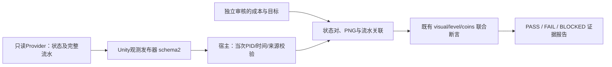

# M3.1：只读状态与货币流水证据闭环

用户已确认从只读状态和金币流水关联开始M3。本环交付可移植协议、Unity合成发布、宿主解析/关联/判定及可复跑样例。真实游戏Provider、升级输入、游戏重打包和五次业务复跑在后续环节完成；不把合成记录称为真实升级通过，不修改当前游戏工作区。

## 选择与结构

采用独立schema2观测协议，保留schema1入口和旧联合断言行为。直接扩充旧schema会使历史消费者混淆可用性；仅靠现有金币事件则缺少升级事务归因。本环新增明确交易标记、连续事件序列和来源绑定，生产核心不写入游戏包名、设备ID、服务器地址或具体控制器类型。

## 观测协议

日志标记为 `AI_TEST_OBSERVATION_JSON:`。旧 `AI_TEST_STATE_JSON:` 不变。所有对象字段均精确校验；重复、未知字段和非有限值被拒绝。

schema2根字段：`schema=2, session_id, seq, frame, provider, source, target, wallet, ledger`。`seq`从1递增，frame非负且不倒退；一个ObservationStream只接受一个session和固定provider/runtime identity，新尝试创建新stream。整数范围为有符号64位，frame为非负32位。

- `source`：`available, build_id, resource_version, dll_version, server`。可用时四项真实字符串齐全；不可用时均为空字符串。
- `target`：`available, target_id, window_id, level, cost, ready`。可用时标识齐全、等级非负、cost为非负精确金额、ready为显式bool。不可用时标识/cost为空、level=-1、ready=false。
- `wallet`：`available, currency_id, balance`。可用时币种非空、余额为非负精确金额；不可用时币种和金额均为空。
- `ledger`：`available, complete, first_seq, last_seq, events`。可用数据可以明确声明不完整；不可用时complete=false、first_seq=1、last_seq=0、events=[]。事件是连续窗口，序号从first_seq到last_seq；空窗口满足first_seq=last_seq+1。
- 每个event字段：`seq, transaction_id, operation_id, kind, target_id, currency_id, delta, balance_after`。kind仅`upgrade`或`external`；upgrade必须有operation/target，external允许这两项为空。transaction_id在窗口内唯一，currency必填，delta为有符号精确金额，balance_after非负。

所有金额都是不含指数/缩写的十进制字符串，长度上限1024；float和以0冒充未知均拒绝。日志上限4MiB，事件上限4096，普通文本上限512字符。货币计算按输入精度和事件数量设置Decimal上下文，不能使用默认28位导致舍入。

Python接口：`bridge_v2.parse_observation_line(line)`、`bridge_v2.ObservationStream(expected_source=None, expected_provider=None).parse_line(line)`。失败不推进stream状态；重复/倒序seq、frame倒退、来源变化、事件回退或重叠内容改变均拒绝。金额/结构校验不等于真实游戏Provider已经可信。

## 离线记录包

根字段为 `schema_version=1, evidence_mode, contract, before, after`。evidence_mode仅`synthetic`或`recorded`。

contract字段为：`approved, reviewer, reviewed_at, source_ref, cost_source_ref, provider, runtime_source, device_alias, pid, target_id, window_id, currency_id, operation_id, expected_cost, trace`。runtime_source含build_id/resource_version/dll_version/server。trace含requirement_id/case_id/source_ref/run_id/attempt_id。审核为真时需真实来源与带时区ISO时间；样例审核人只能明确标成synthetic fixture，不伪造真实用户批准。expected_cost来自独立审核规则，不能自动取被测target.cost。调用方不能直接提供non_upgrade_delta。

before/after各含 `line, capture`。line必须是有设备时间、PID、线程ID、级别及Unity tag的真实格式日志前缀，之后为schema2标记/JSON。contract与capture的pid均为正整数。capture字段为：`device_alias, pid, log_start, log_end, session_id, seq, observer, visual_confirmed, visual_review_ref, screenshot`。observer仅manual/bridge；visual_confirmed是显式来源确认，不是自动图像识别。screenshot含evidence_id/path/bytes/sha256/width/height，复用现有PNG内容校验。

时间使用 `MM-DD HH:MM:SS.mmm`，支持跨年短窗口；日志时间必须落在capture括号中，单capture不超过10秒，前后不得倒序/重叠，总窗口不超过120秒。capture的设备/PID/session/seq必须绑定合同及日志；source、target/window、currency均须一致，两个snapshot必须同session且seq递增、frame不倒退。before/after PNG必须位于显式evidence_root内，文件和evidence_id不同，禁止借用同一路径/硬链接；相同像素本身不证明或否定业务变化。该关联不是同帧原子截图的证明。

## 流水和联合判定

`m3_observation.assess_recording(recording, *, evidence_root)`读取并验证实际文件，返回结构化结果，未知/无效证据返回BLOCKED。

after流水必须完整覆盖 `(before.last_seq, after.last_seq]`，不允许缺口、重复或事务重用。对目标币种从before余额逐事件核对balance_after，最终须与after余额一致；缺失/不一致流水阻塞归因。其他币种事件仍参与序列完整性，不计入目标币种余额。

该区间恰有一个与operation_id/target_id/currency_id绑定的upgrade事件；任何额外升级事件或错误归属都阻塞。其它目标币种external事件求和得non_upgrade_delta。独立expected_cost与实际扣款/展示成本不符是已知FAIL；成本一致后还需等级恰好+1。可用且完整的上下文中调用既有assess_upgrade联合判定，不因“点击送达”或“余额差恰好”通过。

结果固定 `scope=readonly_upgrade_evidence, business_status=NOT_EVALUATED, execution=device_free`，保留evidence_mode、逐项断言、来源、事务和哈希；PASS只代表记录证据满足本合同。没有真实操作证明、不创建M0已执行run、不增加业务执行覆盖。FAIL是记录中已知不符，是否游戏Bug需后续真实接入复核。

## Unity与验证

新增 `GameTestObservationPublisher` 和 `IGameTestObservationProvider.ReadObservation()`，仅显式Install后读Provider；无socket、写金币/等级或自动输入。编译条件沿用 `UNITY_EDITOR || (DEVELOPMENT_BUILD && AI_TEST_AGENT_BRIDGE)`。发布器只生成session/seq/frame并序列化；不得把不可用数据、complete或ready自动改成true。

用独立Unity Host验证合成发布、协议往返和未安装Provider的失败分支。正式游戏Provider未实现，发布构建排除尚需后续真实构建验证。当前v65不能被当前源码DLL任意替换。

CLI：`assess-recording-m3 INPUT --output PATH.json`，显式evidence_root为输入文件父目录；输出相邻Markdown并保留输入指纹。输出采用原子替换且不能覆盖输入/证据。生成可移植合成PASS、错误扣款FAIL、缺失事件BLOCKED样例，两次独立输出复验一致。仍在M3分支交付，用户验收首环后才合并/进入真实接入环。
