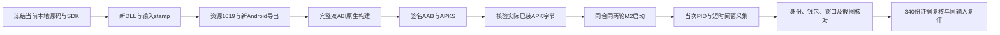

# M3.2：本地基线 Android 专包与实机闭环

更新于2026-10-19。含新桥的Android专用测试包已完成构建、签名核验和Samsung两轮实际安装及只读验证，等待用户验收。最终候选为 **R3，67 / 2.1.2，资源1019，TestServer / Local**。设备215的窗口、等级、成本和钱包均已取得真实样本；本环不包含升级扣款业务验收。



## 构建结果

| 检查点 | 最终R3结果 |
| --- | --- |
| 基线保全 | 87,575个输入文件逐项固定；真实隔离副本，保留当前未提交源码；原工程HEAD与已知脏文件指纹复核一致 |
| SDK | 保留原有Java/Manifest/SDK集成，仅在私有副本修正本次明确的依赖兼容问题 |
| 构建配置 | Android Development、IL2CPP、arm64＋armv7；TestServer、BM Local；资源热更关闭、代码加载入口保留 |
| 显式目标 | terrain47/device215（当前地图7-5的剑制作台）；默认通用Begin入口仍为0/0 |
| 热更DLL | SHA256 `cbd4f0273a6e7e4a0ef06212753cd328f1ea0acc85f61c3f747e787804eda97f` |
| Module MVID | `84fe2804-1531-4fb1-8c83-fe443bf16dca` |
| 输入stamp | `inputs:46f8e86bb2284e34571b9e997f53cd48844213ca4bb772a14669e04bde8fe74a` |
| Unity | fresh configure/resources/export均exit0/PASS；最终导出Succeeded、0 errors；三处DLL/资源字节相同 |
| 实际IL | 最终DLL查询Main100；初始化明确传入47/215；实际AOT加载器将同一byte[]传给Assembly.Load和CaptureLoadedBytes |
| 同步与原生 | 13,375项同步审计匹配；完整双ABI BuildIl2CppTask退出0，各22节点成功、0失败 |
| 签名AAB | 321,007,038字节；SHA256 `865b278953e364ecb01ed3a9efbfadbc3fdff9afebba74a5a0c455c8713ed494` |
| APKS | 429,781,111字节，5个APK；SHA256 `b131fc8b25500d13219b9c0680c0660dae1e27bc5f83ebf286361ab4be89d013` |
| 最终包门禁 | 5/5 APK签名匹配Samsung原安装；两个base变体均67/2.1.2；实际资源1019、TestServer/Local配置通过标准M2预检 |
| 包内绑定 | 两ABI新原生库、热更资源包、版本文件与冻结构建一致；两个base code APK的DEX实际定义所需Billing类 |

包体、完整游戏源码、SDK、签名材料、设备标识、账号标识、原始日志与截图只留本地私有目录。R1/R2旧包和失败证据完整保留，不覆盖重标为成功。

## 两轮实机结果

两轮均使用同一最终合同，保留数据更新安装并重新启动；run、attempt、PID和桥session各不相同。M2沿用用户批准的场景回调里程碑、连续3次进程/前台稳定且无归属本包的致命崩溃或ANR，仅判断startup_readiness。

| 检查项 | 第一轮 | 第二轮 |
| --- | --- | --- |
| M2 | PASS / READINESS_CONFIRMED | PASS / READINESS_CONFIRMED |
| 实际加载身份 | 最终DLL SHA、MVID、stamp均匹配 | 同一最终清单，匹配 |
| source | available；1019 / TestServer | available；1019 / TestServer |
| target | terrain47/device215，UIUpgradeWindow | 同一明确目标和窗口 |
| 等级 | 1，已有存档与运行等级一致 | 1，已有存档与运行等级一致 |
| 成本原值 | 8708971337959.25 | 8708971337959.25 |
| 实际截图 | 等级1，按钮8.71T | 等级1，按钮8.71T |
| Coin钱包 | available；原值保存于本地录制 | available；原值保存于本地录制 |
| 引用文件 | 170份核验通过 | 170份核验通过 |
| ledger | unavailable / incomplete | unavailable / incomplete |

两张PNG均由实际ADB命令采集，在本轮同PID、短设备时间窗内保存，并核对PNG字节及SHA。截图按钮的8.71T与成本原值在其显示精度下相容；这不构成独立成本配置正确性或扣款正确性的断言。钱包会随游戏正常运行变化，截图缩写和日志采样也有时间差，不把两轮余额差当成升级交易。

两轮最终录制再次调用严格宿主核验，**340份引用文件重新核对大小及SHA通过**。对第二轮同一输入执行两次标准inspect-provider-m3命令：均PASS，input SHA相同、assessment ID不同。报告保持execution=device_free、live_provider=false和business_status=NOT_EVALUATED；实际ADB命令轨迹及当次PID/设备时间窗单独证明实时采集。

## 实测发现与修复

- **Android DLL身份来源。** 本工具链的RuntimeModule GUID接口无法返回有效MVID，改为从实际加载字节解析PE/CLI Module表，Android标记loaded_pe_metadata；Editor仍与runtime API交叉核对。宿主独立读取同次DLL字节计算SHA及MVID，身份和manifest为schema2。
- **采样与资源版本。** 每次observation前配对输出已捕获身份，不重置session/seq；Local读取真实内置资源版本。M2正常空stdout/stderr仍核对空文件SHA，DLL和桥日志保持非空。
- **SDK兼容。** 当前Unity IAP 5.4.2要求Billing9.0.0，保留SDK6.2.1缺类。私有工程精确对齐Billing、按AAR要求compileSdk35、用Kotlin BOM1.8.22消除20个重复类。旧D8 4.0.52在实际Core1.15.0 JAR上复现崩溃，按[R8官方机制](https://r8.googlesource.com/r8/+/refs/heads/main/README.md#replacing-r8-in-android-gradle-plugin)仅覆盖工具为8.1.56；实际插件classloader与完整bundle均核验通过。AGP、Gradle、JDK、targetSdk和minSdk保持原版本，支付业务未执行。
- **目标与UI映射。** 保存账号在地块47，普通UI不能返回地块1，因此在保留存档前提下明确选47/215，不拿其他地图余额填充。R2真实设备窗口打开后仍被漏读，确认配置4属于Main100、旧适配器误扫PopUp200；R3仅修正此映射，保留同对象、可见性及等级一致等门禁。

系统权限弹窗、Game Booster触摸保护和人工同时操作造成的中断均保留失败样本；用户暂停手动操作后完成最终目标采集。正常离线收益窗口的X会由游戏结算基础奖励，单独留证后重取基线，不声称账号余额全程不变。不通过GM、写存档或点击升级来制造只读状态。

## 回归与验收方法

- Python完整回归 **458项通过**（2026-10-19新运行），compileall退出0。
- C#真实分组夹具先RED；修正后Editor/Android各10行为＋10隔离边界通过，覆盖错误分组、关闭、非活动、同ID不同对象和存档等级不符；release/未opt-in类型排除通过。
- 原游戏完整热更源码隔离编译通过；PE32/PE32+、ExtraData及截断边界做C#/Python交叉核验。合成测试不充当实机证据。
- 公开[构建recipe](../../integrations/unity-test-bridge/Editor/BuildRecipes/README.md)与实际私有编排规范化body一致；241份真实引用指纹不变，3组守卫编译和7项路径探测通过。该recipe需要项目私有构建输入，通用桥不依赖此项目API。

本轮Local包不请求远端版本，M2合同expected_resource_version=null；资源1019由最终包文件和M3当次source交叉验证，不伪造localVersion/remoteVersion日志。复跑与复评入口为：

```text
python -m ai_test_agent m2-smoke --contract <final-contract.json>
python -m ai_test_agent inspect-provider-m3 <device-recording.json> --output <new-review.json>
```

本地交付索引另提供最终包、合同、两轮录制、截图和不可变构建证据的准确路径。验收时先核对最终包SHA，再查两轮目标与截图及同输入复评结果。主分支按用户要求在验收通过后合并。

**边界：** 本轮完成专包的实际桥接与只读闭环。账本仍不可用，未证明首次升级金币扣减正确、五次业务复跑或M3全部完成。[此前源码/Editor验证](2026-10-16-m32-runtime-provider.md)保留原提交的历史数据。
